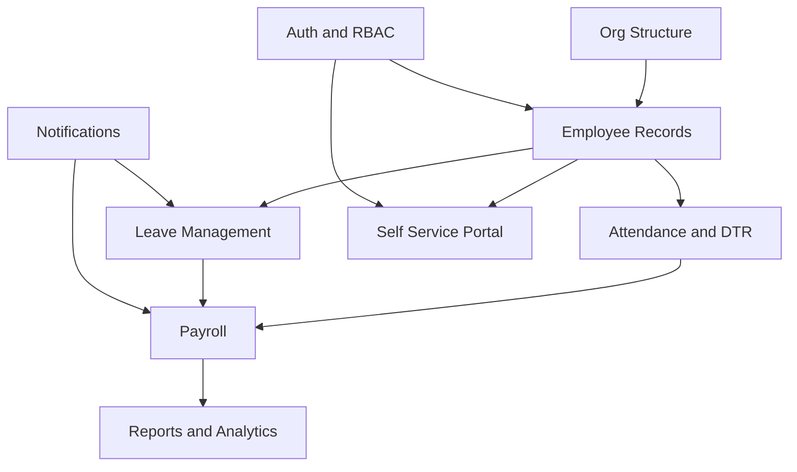

# Start Here

- Incident submit correction (2026-10-27): Others nature specification optional, no200-character requirement/cap; BR-785 updated. Both PHP lint passed; John checks submission. See [[Session-Log]].

- Assistant handoff (John, 2026-10-29): Claude and Codex work independently; cross-assistant handoff requires John's explicit request. Share project status through [[Session-Log]]. See [[Codex-Agent-Workflow]].

- Current approved implementation: [[2026-10-27-dashboard-incident-template]] (dashboard cleanup, handler status affordance, exact-template confidential Incident documents; period/report picker deferred).

- [[Claude-Agents-and-Skills]] - Claude agents, READ BUDGET and token rules (John, 2026-10-28).
- [[Codex-Agent-Workflow]] - current Codex-only, low-usage workflow and Obsidian scope.

The dashboard for the HRIS planning vault. Everything is reachable from this note.

> [!important] The vault is the ONLY source of truth. Every patch must sync it before its final report (see [[Conventions]], CLAUDE.md, `.claude/skills/hris-patch`). Ticket engine hub: [[Employee-Tickets]].

> [!note] Reading order for a first pass
> [[Vision-and-Scope]] → [[Personas]] → [[Roadmap]] → [[Data-Model]] → [[Build-Plan]] → [[Claude-Code-Brief]].

## Decide first

These block real work. See [[Open-Questions]] for the full checklist.

- [ ] [[ADR-001-Tech-Stack]] — stay on PHP/MySQL or rewrite?
- [ ] [[ADR-002-Multi-Tenancy]] — one company or many?
- [ ] [[ADR-003-Payroll-Engine-Approach]] — rules as config or as code?
- [ ] Payroll cut-off calendar and pay frequency (see [[Payroll]])
- [ ] Whether biometrics integrate live or by file import (see [[Attendance-and-DTR]])

## Product

- [[Vision-and-Scope]] — problem, goals, non-goals, success metrics
- [[Personas]] — HR admin, payroll officer, approver, employee, system admin
- [[User-Stories]] — US-### backlog, MoSCoW prioritised
- [[Roadmap]] — MVP → v1 → later
- [[Open-Questions]] — open decisions as a checklist

## Modules

| Module | Phase | Note |
|---|---|---|
| Employee 201 records | MVP | [[Employee-Records]] |
| Company / org structure | MVP | [[Org-Structure]] |
| Attendance & DTR | MVP | [[Attendance-and-DTR]] |
| Leave management | MVP | [[Leave-Management]] |
| Payroll | MVP | [[Payroll]] |
| Auth & RBAC | MVP | [[Auth-and-RBAC]] |
| Self-service portal | v1 | [[Self-Service-Portal]] |
| HR tickets (HR Concerns, built) | v1 | [[Employee-Tickets]] |
| Reports & government filings | v1 | [[Reports-and-Analytics]] |
| Notifications | v1 | [[Notifications]] |
| Recruitment & onboarding | v1 | [[Recruitment-and-Onboarding]] |
| Offboarding & clearance | v1 | [[Offboarding-and-Clearance]] |
| Performance management | Later | [[Performance-Management]] |

## Design

- [[Data-Model]] — entities, key fields, ER diagram, as-built ticket tables (migrations 001-016)
- [[Architecture]] — layers, deployment, stack options
- [[API-Surface]] — endpoints per module
- [[Screens]] — SCR-### screen inventory (HR request screens SCR-750..767)
- [[Design-System]] — UI tokens, shell, branding, delivery rule
- [[Security-and-Compliance]] — RA 10173, PII, retention, audit
- [[Business-Rules]] — BR-### computation rules

## Decisions

- [[Decision-Log]] — index
- [[ADR-000-Template]] · [[ADR-001-Tech-Stack]] · [[ADR-002-Multi-Tenancy]] · [[ADR-003-Payroll-Engine-Approach]]

## Implementation

- [[Build-Plan]] — vertical slices in dependency order
- [[Claude-Code-Brief]] — copy-paste brief for Claude Code
- [[Progress]] — per-slice status

## Reference & meta

- [[Codex-First]] - SUPERSEDED: BINAWI 2026-10-27: Claude Code + sariling subagents + advisor na ulit; walang codex exec maliban kung hilingin ni John.
- [[PH-Labor-and-Payroll-Notes]] · [[Glossary]] · [[Conventions]] · [[README]]

- 2026-10-28 PMBSI positions: Human Resource only for now, pending company confirmation. See [[Employee-Records]] and [[Decision-Log]].

## Codex low-usage routing
See [[Codex-Agent-Workflow]] for current rules and [[Decision-Log]] for history.

- 2026-10-29: Aligned Codex agent and skill instructions with the current bounded-context workflow; static checks only, actual usage savings unmeasured.

- 2026-10-29: Registered six HRIS Codex roles; local discovery verified four skills and six role entries. See [[Codex-Agent-Workflow]].

- 2026-10-29: Task requests authorize relevant source reads and scoped edits without repeated permission prompts; see [[Codex-Agent-Workflow]].
