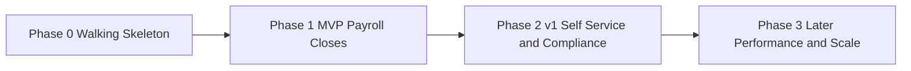

# Roadmap

Three horizons. The ordering principle: **nothing ships until one real payroll cut-off can run end to end.** Features that do not serve that are deferred, however attractive.

Slice-level sequencing lives in [[Build-Plan]]; this note is the outcome-level view.

## Phase 0 — Walking skeleton

**Goal:** one thin path through every layer, deployed, with auth working. Proves the architecture before any domain depth.

Ships:
- Login, session, role assignment, one protected page per portal — [[Auth-and-RBAC]]
- Company / branch / department / position masters, minimal CRUD — [[Org-Structure]]
- Employee list and a single employee detail page reading real data — [[Employee-Records]]
- Audit log table written on at least one action — [[Security-and-Compliance]]
- Migrations, seed data, a test harness, and a repeatable local run

**Exit criterion:** an HR admin logs in, creates a department, creates an employee, and the action appears in the audit log.

> [!note] Brownfield reality
> Much of Phase 0 already exists in the current PHP codebase. Phase 0 here means *verify and consolidate it against this vault's model*, not rebuild it. Resolve [[ADR-001-Tech-Stack]] before deciding how much to keep.

## Phase 1 — MVP: payroll closes without a spreadsheet

**Goal:** the metric in [[Vision-and-Scope]] — one cut-off closed in under four hours, reproducibly.

Ships:

| Area | What exactly |
|---|---|
| [[Employee-Records]] | Full 201: personal, employment with dated status, government IDs with completeness validation, dated compensation, documents, dependents |
| [[Org-Structure]] | Reporting lines, cost centers, holiday calendar with per-branch local holidays |
| [[Attendance-and-DTR]] | Shift schedules, punch import, derived DTR with late/undertime/OT/night diff/day type, corrections with audit, DTR lock, missing-attendance exception list |
| [[Leave-Management]] | Leave types with accrual, filing, approval routing, single balance ledger, paid leave flowing into the DTR |
| [[Payroll]] | Run lifecycle draft→computed→reviewed→released, earnings from DTR, statutory deductions from versioned rate tables, withholding tax, one-off adjustments, register, payslip, reversal of unreleased runs, recompute-and-match |
| [[Auth-and-RBAC]] | Full permission matrix with scope enforcement, separation of duties |
| [[Business-Rules]] | Every BR in the computation path implemented and unit-tested against worked examples |

Explicitly **not** in MVP: bank files (US-515), performance (US-820/821), tax annualisation, PWA.

**Exit criteria:**
1. A real cut-off runs and the register reconciles against Payroll Officer's own spreadsheet to the peso.
2. Recomputing the released run produces byte-identical figures.
3. Every statutory rate in use is a dated config row, with its source circular recorded.
4. Drill-down from net pay to raw punch works for any employee in the run.

## Phase 2 — v1: self-service and compliance

**Goal:** stop HR being the lookup service, and stop re-keying government reports.

Ships:
- [[Self-Service-Portal]] — payslips, own DTR, leave filing, 201 view, change requests, mobile-usable
- [[Notifications]] — approval requests with deep links, leave outcomes, payslip release, probation and contract expiry
- [[Reports-and-Analytics]] — SSS contribution list, PhilHealth RF-1, Pag-IBIG MCRF, BIR alphalist and 2316, headcount, attendance summary, payroll journal export
- [[Recruitment-and-Onboarding]] — applicant-to-employee conversion without re-typing, onboarding checklist
- [[Offboarding-and-Clearance]] — clearance checklist gating final pay
- 13th month pay run and final pay computation
- Bank payment file export, once a bank format is confirmed
- [[Security-and-Compliance]] — retention policy enforced, privacy notice and consent captured, PII access logged

**Exit criteria:** an employee resolves a payslip and leave-balance question without contacting HR; each statutory report is generated rather than typed; a separation completes clearance → final pay → 2316 in-system.

## Phase 3 — Later

Only after v1 is in daily use.

- [[Performance-Management]] — review cycles, goals, competencies, calibration
- Training and certification tracking
- Advanced analytics: turnover prediction, cost-per-hire, attendance trend dashboards
- Multi-company support, if [[ADR-002-Multi-Tenancy]] lands that way
- API for third-party integrations, timekeeping device push, HMO vendor feeds
- PWA / offline DTR capture for field employees
- Tax annualisation automation

## Deliberately deferred, with reasons

| Item | Why deferred |
|---|---|
| Multi-company | Adds a tenant column to every table and a scope check to every query. Do it once, deliberately — see [[ADR-002-Multi-Tenancy]] — not accidentally. |
| Performance management | Zero overlap with the payroll critical path. Highest-effort, lowest-urgency module. |
| Mobile app | Responsive web covers the four employee jobs. Revisit only if field connectivity forces it. |
| Workflow engine | A generic approval engine is tempting and expensive. Hardcode leave and OT approval first, extract the engine when a third workflow appears. |

## Dates

Intentionally none. A single developer plus Claude Code should sequence by dependency and demo, not by invented dates. If a date is needed for a client, derive it from [[Build-Plan]] slice counts after the first two slices give a real velocity signal.

Related: [[Vision-and-Scope]] · [[Build-Plan]] · [[User-Stories]] · [[Progress]] · [[Open-Questions]]
