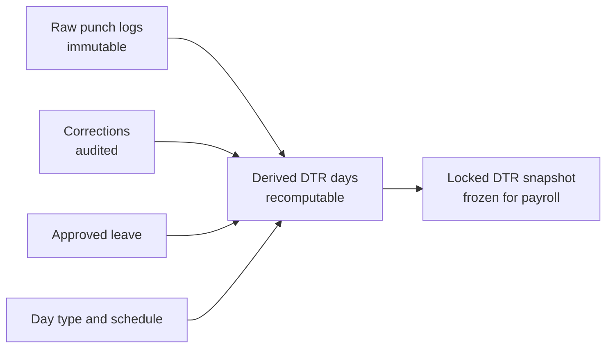

# Attendance and DTR

## Purpose

Turn raw time punches into a reviewable, lockable Daily Time Record that [[Payroll]] can compute from. This is the module that eats the most HR time today and causes the most payroll disputes, so it gets the most care.

The architectural spine is a three-layer separation that must not be collapsed:

- **Raw logs are immutable.** Whatever the biometric device said, stays. Never edit a punch.
- **The DTR is derived and recomputable.** Change a shift assignment or add a correction, and the DTR regenerates from raw logs plus corrections. No hand-typed totals.
- **The lock creates a snapshot.** Payroll computes on a frozen copy, so a later correction cannot silently change a run that already paid.

> [!warning] The most common design mistake
> Letting HR edit the DTR directly. It feels faster and it destroys auditability: six months later nobody can tell whether 9 hours was what the device recorded or what someone typed. Corrections are *additional rows*, with a reason and an actor, that the derivation consumes.

## Scope

### In scope

- Shift templates and schedule assignment per employee, with effectivity dates
- Punch ingestion: biometric import, manual entry, self-service punch
- Punch pairing into in/out sessions, including multiple sessions per day
- DTR derivation: hours worked, late, undertime, overtime, night differential hours, day type
- Overtime filing and approval
- DTR corrections with reason codes and audit
- Attendance exception lists: no punch, single punch, no schedule, excessive hours
- DTR review, approval and lock per cut-off
- Employee visibility of their own DTR during the open cut-off
- Team attendance views for managers
- Integration points: approved leave from [[Leave-Management]], day type from [[Org-Structure]]

### Out of scope

- Pay computation and rates → [[Payroll]] (this module produces *hours*, not pesos)
- Leave balance and entitlement → [[Leave-Management]]
- Holiday calendar maintenance → [[Org-Structure]]
- Biometric device administration, enrolment and firmware → vendor tooling, see Q5 in [[Open-Questions]]
- Geofencing and GPS verification → later consideration

## Key Entities

| Entity | Purpose | Notable fields |
|---|---|---|
| `attendance_raw_logs` | Immutable punch records exactly as received. | `id`, `employee_id`, `device_id`, `punch_at`, `punch_direction` (`IN`/`OUT`/`UNKNOWN`), `source` (`BIOMETRIC`/`MANUAL`/`PORTAL`/`IMPORT`), `import_batch_id`, `raw_payload`, `received_at` |
| `attendance_import_batches` | One upload. Enables full-batch reversal. | `id`, `file_name`, `file_hash`, `period_from`, `period_to`, `rows_total`, `rows_accepted`, `rows_rejected`, `imported_by`, `status` |
| `attendance_import_rejects` | Why each rejected row failed. | `batch_id`, `line_no`, `raw_line`, `reason` |
| `employee_schedules` | Dated schedule assignment. | `employee_id`, `work_schedule_id`, `effective_from`, `effective_to` |
| `dtr_days` | One derived row per employee per date. The module's output. | `employee_id`, `work_date`, `shift_template_id`, `day_type`, `is_rest_day`, `scheduled_in`, `scheduled_out`, `actual_in`, `actual_out`, `hours_worked`, `hours_regular`, `hours_ot`, `hours_night_diff`, `minutes_late`, `minutes_undertime`, `leave_hours`, `status` (`DERIVED`/`FLAGGED`/`REVIEWED`/`LOCKED`), `derived_at`, `rules_version` |
| `dtr_sessions` | The paired in/out sessions behind one DTR day. | `dtr_day_id`, `sequence_no`, `time_in`, `time_out`, `source_log_in_id`, `source_log_out_id`, `minutes` |
| `dtr_corrections` | Audited adjustments consumed by derivation. | `id`, `employee_id`, `work_date`, `correction_type`, `proposed_in`, `proposed_out`, `reason_code`, `reason_text`, `requested_by`, `approved_by`, `approved_at`, `status` |
| `overtime_requests` | Pre- or post-filed OT needing approval. | `id`, `employee_id`, `work_date`, `hours_requested`, `hours_approved`, `reason`, `status`, `approved_by` |
| `dtr_locks` | The freeze record per cut-off. | `id`, `payroll_period_id`, `locked_at`, `locked_by`, `employee_count`, `snapshot_hash` |
| `dtr_day_snapshots` | Frozen copy of `dtr_days` at lock time. | `dtr_lock_id`, plus all `dtr_days` columns |
| `attendance_devices` | Known biometric terminals. | `id`, `code`, `name`, `branch_id`, `device_user_id_map`, `active` |

## Core Flows

### Flow 1 — Import biometric punches

1. Payroll officer uploads the device export on SCR-301, choosing the date range it covers.
2. System hashes the file. An identical hash already imported raises a duplicate warning naming the earlier batch.
3. Parser reads each line and maps the device's user ID to an `employee_id` via `attendance_devices.device_user_id_map`.
4. Every row is validated without writing: known employee, parseable timestamp, timestamp within the declared range, not already present.
5. A dry-run report shows accepted and rejected counts with reasons per reject.
6. On confirm, accepted rows insert into `attendance_raw_logs` under one batch ID. Rejects persist in `attendance_import_rejects` for follow-up.
7. DTR derivation is queued for the affected employees and dates.

### Flow 2 — Derive the DTR for an employee-date

This is the core algorithm. It must be a pure function of its inputs so it is testable and re-runnable.

1. Resolve the employee's schedule as of `work_date`; get the shift template, required hours, break minutes, rest-day flag.
2. Resolve the day type from [[Org-Structure]] — holiday type plus rest-day status (BR-310).
3. Collect raw logs for the shift window. For a midnight-crossing shift, the window extends into the next calendar day but all hours attribute to the shift start date (BR-107 / BR-309).
4. Pair punches into sessions: in→out, in order. An unmatched punch flags the day rather than guessing a partner.
5. Apply any approved `dtr_corrections` for the date, which may supply, replace or void a session.
6. Subtract unpaid break time per the shift template, unless the employee worked through a break with approval.
7. Compute `hours_worked` from sessions.
8. Compute `minutes_late` against scheduled in, after the configured grace period (BR-301).
9. Compute `minutes_undertime` against scheduled out (BR-302).
10. Split hours into regular and overtime at the required-hours boundary; OT hours count only up to `overtime_requests.hours_approved` if OT approval is required (BR-303).
11. Compute `hours_night_diff` as the overlap between worked sessions and the statutory night window (BR-306).
12. Overlay approved paid leave from [[Leave-Management]] as `leave_hours` (BR-401).
13. Set status: `DERIVED` if clean, `FLAGGED` if any exception applies.
14. Stamp `derived_at` and `rules_version` so a later recompute is comparable.

### Flow 3 — Review and resolve exceptions

1. Payroll officer opens SCR-300 filtered to `FLAGGED` days for the cut-off.
2. Exception types shown: no punch at all, single punch, overlapping sessions, hours exceeding a sanity ceiling, no schedule assigned, OT without approval, punch outside any shift window.
3. For each, the officer either files a correction with a reason code, or confirms the day as-is (e.g. a genuine absence).
4. Employees with *zero* attendance for the whole cut-off get their own list (FR-311) — the most dangerous silent failure is an employee unpaid because their device record never arrived.
5. Corrections trigger re-derivation of just the affected days.

### Flow 4 — Employee disputes a day

1. Employee views their DTR on SCR-720 while the cut-off is still open.
2. Files a correction request for a specific date with a reason.
3. Request routes to their manager, then to the payroll officer, per the configured chain.
4. On approval, a `dtr_corrections` row is created and derivation re-runs. Employee is notified.
5. After lock, the portal shows the locked figures and disputes become next-period adjustments.

### Flow 5 — Overtime approval

1. Employee or manager files OT for a date, ideally before it is worked.
2. Manager approves hours, which may be fewer than requested.
3. Derivation caps paid OT at approved hours. Unapproved excess is visible as `hours_worked` but contributes zero paid OT, keeping the discrepancy visible rather than hidden.
4. If the company pays all worked OT without pre-approval, the requirement is a config flag — do not assume either policy.

### Flow 6 — Lock the DTR for a cut-off

1. Payroll officer requests a lock for the payroll period.
2. System blocks the lock if any day for an included employee is still `FLAGGED` or if the zero-attendance list is non-empty and unacknowledged.
3. On lock: all `dtr_days` for the period are copied into `dtr_day_snapshots`, a `snapshot_hash` is computed, and status becomes `LOCKED`.
4. Further corrections for locked dates are permitted but do not alter the snapshot; they are tagged for the next period.
5. [[Payroll]] may now create a run, reading only the snapshot.
6. Unlock is possible only while no payroll run on the period has been released, and is itself audited.

## Business Rules

Full definitions in [[Business-Rules]].

- **BR-301** — Tardiness is the positive difference between actual in and scheduled in, after a configurable grace period. The grace period does not reduce the deduction once exceeded, unless policy says otherwise.
- **BR-302** — Undertime is the positive difference between scheduled out and actual out, counted separately from tardiness. Both can occur on one day.
- **BR-303** — Overtime is hours beyond the shift's required hours, capped at approved hours when OT approval is required.
- **BR-304** — The OT multiplier depends on the day type: ordinary day, rest day, special non-working day, regular holiday, and combinations.
- **BR-306** — Night differential applies to the overlap between hours actually worked and the statutory night window, and may coincide with overtime, in which case both premiums apply.
- **BR-307** — Hours worked never includes unpaid break time.
- **BR-308** — Raw punch logs are append-only. No update, no delete, except full reversal of an import batch that has not been locked.
- **BR-309** — A midnight-crossing shift attributes all hours to the shift start date.
- **BR-310** — Day type is a combination, not a single value: `{holiday_type, is_rest_day}`. Resolution order and multipliers are in [[Business-Rules]].
- **BR-311** — A locked DTR snapshot is immutable. Payroll must read the snapshot, never the live `dtr_days`.
- **BR-312** — Approved paid leave fills scheduled hours as `leave_hours` and must not also count as `hours_worked`. Double-counting leave is a classic overpayment bug.

> [!warning] NEEDS VERIFICATION
> The night differential window, the night differential percentage, and every overtime and holiday multiplier are statutory. They are referenced as mechanisms above and as config in [[Business-Rules]]; no numeric value is asserted anywhere in this vault. Confirm against the Labor Code and the current DOLE handbook before coding, and store them as effectivity-dated config rows.

## Functional Requirements

| ID | Requirement | Priority |
|---|---|---|
| FR-301 | The system shall import biometric punch logs for a date range and report accepted and rejected rows with a reason per rejection. (US-301) | Must |
| FR-302 | The system shall store raw punch logs immutably and append-only. (BR-308) | Must |
| FR-303 | The system shall detect a re-upload of an identical file by hash and warn before importing. | Should |
| FR-304 | The system shall allow reversal of an entire unlocked import batch. | Should |
| FR-305 | The system shall derive one DTR day per employee per date from raw logs, corrections, schedule, day type and approved leave. (US-302) | Must |
| FR-306 | The system shall compute hours worked, regular hours, overtime hours, night differential hours, tardiness minutes and undertime minutes per DTR day. (US-302) | Must |
| FR-307 | The system shall re-derive a DTR day on demand and produce identical results from identical inputs. | Must |
| FR-308 | The system shall record the rules version used for each derivation. | Should |
| FR-309 | The system shall assign work schedules to employees with effectivity dates. (US-303) | Must |
| FR-310 | The system shall support shifts that cross midnight and attribute their hours to the shift start date. (US-309, BR-309) | Must |
| FR-311 | The system shall list employees with no attendance records at all for a cut-off, and shall require acknowledgement before the DTR can be locked. (US-311) | Must |
| FR-312 | The system shall flag DTR days with unpaired punches, overlapping sessions, missing schedules or implausible hours. | Must |
| FR-313 | The system shall allow an audited correction with a reason code, which derivation consumes without altering raw logs. (US-304) | Must |
| FR-314 | The system shall allow an employee to view their own DTR for an open cut-off and file a correction request. (US-306) | Must |
| FR-315 | The system shall route overtime for manager approval and shall cap paid OT at approved hours when approval is required. (US-307) | Must |
| FR-316 | The system shall display the resolved day type per DTR day. (US-308) | Must |
| FR-317 | The system shall lock the DTR for a cut-off, creating an immutable snapshot payroll reads from. (US-305, BR-311) | Must |
| FR-318 | The system shall prevent locking while unresolved flagged days remain for included employees. | Must |
| FR-319 | The system shall allow unlock only while no payroll run on the period is released, with an audit entry. | Must |
| FR-320 | The system shall allow manual time entry when the device is unavailable, marked with source `MANUAL`. (US-310) | Should |
| FR-321 | The system shall support a configurable tardiness grace period. (US-312) | Should |
| FR-322 | The system shall provide a manager view of team attendance for a date range. (US-305, US-310) | Should |
| FR-323 | The system shall map device user IDs to employees and shall reject punches for unmapped IDs rather than discarding them silently. | Must |
| FR-324 | The system shall support multiple in/out sessions per day. | Must |
| FR-325 | The system shall never allow direct editing of a derived DTR total. | Must |

## Edge Cases

| Case | Expected handling |
|---|---|
| Employee punches in but never out | Day flags as unpaired. Never auto-close at shift end — that fabricates hours. Requires a correction. |
| Employee punches out twice | Second OUT without an intervening IN is retained raw and flagged; pairing takes the first valid pair and surfaces the rest. |
| Punch recorded on the wrong device | Accepted. Branch mismatch is a flag, not a rejection. |
| Device clock drift | Detectable as a systematic offset. Record a per-device clock offset and apply at derivation; do not edit raw logs. |
| Device offline for days, logs arrive late | Import works for any past range. Dates already locked are tagged for next-period adjustment and do not alter the snapshot. |
| Night shift spanning a holiday boundary | Hours attribute to the shift start date, so the day type is the start date's. Document this explicitly — it is a real dispute source. |
| Employee works on their rest day without approval | Hours are recorded; whether they are paid at the rest-day premium is an approval question, not a recording question. |
| Half-day leave plus a half day worked | `leave_hours` plus `hours_worked` must sum to no more than scheduled hours. Validate it. |
| Employee on paid leave who also punches in | Flag the conflict. Do not pay both. BR-312. |
| Suspended employee with punches | Suspension period marks days unpaid regardless of punches. Needs an employment-status overlay. |
| Employee with no schedule assigned | Cannot derive required hours. Day flags as `no schedule`, blocking the lock. Never default to eight hours silently. |
| 24-hour or double-shift day | Sanity ceiling flags it for review rather than rejecting it; some operations genuinely do this. |
| Daylight saving | Not applicable in the Philippines, but store timestamps with an explicit timezone anyway so a future change is survivable. |
| Retroactive shift-schedule change | Re-derivation changes past unlocked days. Locked days are untouched. Warn the user which dates will change before saving. |
| Field employee with no biometric access | Manual entry or portal punch, with source recorded so the proportion of manual attendance is auditable. |

## Open Questions

- [ ] How does attendance arrive — live integration, scheduled file, or manual upload? Which device model? → Q5 in [[Open-Questions]]
- [ ] Does the device export punch direction, or only a timestamp? If only timestamps, pairing is positional and much more fragile.
- [ ] Is overtime pre-approval mandatory, or is all worked OT paid?
- [ ] Is tardiness deducted from pay, or only tracked for discipline? (changes whether it reaches [[Payroll]])
- [ ] Are breaks fixed by schedule or punched?
- [ ] Does a rest-day worked automatically grant OT premium, or require approval?
- [ ] Should employees be able to punch from the portal, and if so with what anti-abuse control?
- [ ] What is the sanity ceiling for hours per day before a flag?

## Related

[[Payroll]] · [[Leave-Management]] · [[Org-Structure]] · [[Employee-Records]] · [[Self-Service-Portal]] · [[Notifications]] · [[Business-Rules]] · [[Data-Model]] · [[API-Surface]] · [[Screens]] · [[Reports-and-Analytics]] · [[PH-Labor-and-Payroll-Notes]] · [[ADR-003-Payroll-Engine-Approach]]
