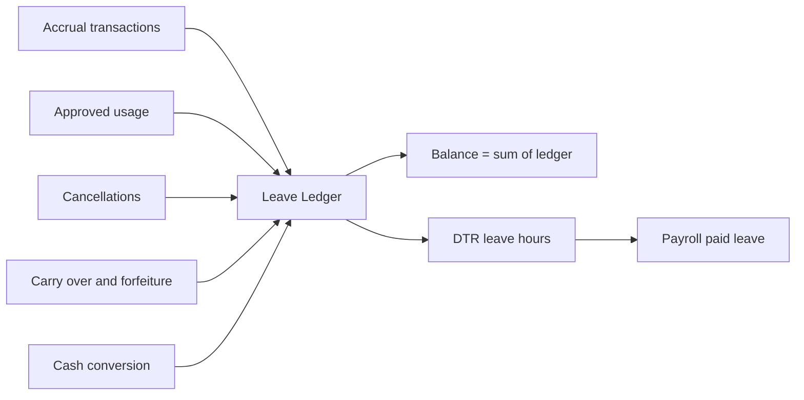

# Leave Management

## Purpose

One honest leave balance per employee per leave type, and an approval flow that produces an auditable decision. Today filed leave, approved leave and paid leave live in different places and disagree; here they are three states of one ledger.

The design choice that makes this work: **leave balance is never a stored number that gets incremented.** It is the sum of a ledger of dated transactions — accruals, usage, cancellations, carry-overs, forfeitures, conversions. A stored counter drifts the first time a transaction is rolled back; a ledger cannot.

## Scope

### In scope

- Leave type configuration: statutory and company types, accrual rules, carry-over, cash convertibility, documentation requirements
- Accrual processing: monthly, annual grant, or on-anniversary
- Leave filing by employee and on-behalf filing by HR
- Multi-level approval routing with delegation
- Leave ledger and derived balances split into earned / used / pending / available
- Half-day and partial-day leave
- Leave cancellation and balance restoration
- Year-end processing: carry-over, forfeiture, cash conversion
- Maternity leave handling including SSS benefit and salary differential
- Team leave calendar and overlap warnings
- Supporting document attachment
- Integration: approved paid leave becomes `leave_hours` in [[Attendance-and-DTR]], then pay in [[Payroll]]

### Out of scope

- Attendance derivation → [[Attendance-and-DTR]]
- Pay computation of leave → [[Payroll]]
- Unpaid absence and AWOL discipline → [[Attendance-and-DTR]] plus HR policy
- Holiday calendar → [[Org-Structure]]
- Benefits administration beyond leave → out of scope entirely per [[Vision-and-Scope]]

## Philippine leave types

These are the types the system must be able to express. Entitlement figures are deliberately omitted.

| Type | Nature | Notes for configuration |
|---|---|---|
| **SIL** — Service Incentive Leave | Statutory | Minimum paid leave for qualifying employees after a service threshold; unused portion is convertible to cash. Many employers absorb SIL into VL/SL — the system must support either arrangement. |
| **VL** — Vacation Leave | Company | Usually accrued monthly, carry-over capped, often convertible. Requires advance filing. |
| **SL** — Sick Leave | Company | Usually accrued monthly, often requires a medical certificate beyond a threshold of consecutive days, frequently non-convertible. Filed retroactively by nature. |
| **Maternity Leave** | Statutory | Expanded maternity benefit; SSS reimburses the employer, and the employer owes a salary differential. Has an allocation option to the child's father or an alternate caregiver. Longest and most complex type. |
| **Paternity Leave** | Statutory | For a married male employee, for the first four deliveries of the legitimate spouse. |
| **Solo Parent Leave** | Statutory | Requires a valid Solo Parent ID on file; the ID has a validity period that must be tracked. |
| **Special Leave for Women** | Statutory | Following surgery for a gynecological disorder, under the Magna Carta of Women. Requires medical documentation and a service requirement. |
| **Leave for Victims of Violence (VAWC)** | Statutory | Confidential by nature — see the privacy note below. |
| **Bereavement Leave** | Company | Covered relatives defined by policy. |
| **Unpaid Leave / Leave Without Pay** | Administrative | No balance; records the absence as authorised but unpaid, and must reduce pay in [[Payroll]]. |
| **Offset / Time-off in lieu** | Company | Where approved OT is banked as time off instead of pay. Only if company policy allows — it interacts with OT pay rules. |

> [!warning] NEEDS VERIFICATION
> Every entitlement period, service requirement, accrual quantum, qualifying condition and conversion rule for the statutory types above is set by its governing statute and implementing rules, and several have been amended in recent years. No number appears here on purpose. Confirm each against the current law and DOLE issuance, record it in [[PH-Labor-and-Payroll-Notes]], and configure it as data — see [[ADR-003-Payroll-Engine-Approach]].

> [!note] Privacy
> VAWC leave, special leave for women, and medical certificates attached to sick leave are sensitive personal information under RA 10173. The reason text and attachments must be visible to a tightly limited role set, and the leave type itself may need masking on shared calendars. See [[Security-and-Compliance]].

## Key Entities

| Entity | Purpose | Notable fields |
|---|---|---|
| `leave_types` | Configuration per type. | `id`, `code`, `name`, `is_statutory`, `is_paid`, `accrual_method` (`MONTHLY`/`ANNUAL_GRANT`/`ANNIVERSARY`/`NONE`), `accrual_quantum`, `max_balance`, `carry_over_policy`, `carry_over_cap`, `is_convertible`, `requires_document`, `document_threshold_days`, `min_notice_days`, `allows_half_day`, `gender_restriction`, `requires_valid_id_type`, `active` |
| `leave_entitlement_rules` | Service-based variation within a type. | `leave_type_id`, `min_service_months`, `employment_status_id`, `quantum`, `effective_from` |
| `leave_ledger` | Every balance-affecting transaction. Append-only. | `id`, `employee_id`, `leave_type_id`, `txn_type` (`ACCRUAL`/`USAGE`/`CANCEL`/`CARRY_OVER`/`FORFEIT`/`CONVERT`/`ADJUSTMENT`), `days`, `hours`, `txn_date`, `leave_year`, `reference_type`, `reference_id`, `remarks`, `created_by` |
| `leave_requests` | A filing and its lifecycle. | `id`, `employee_id`, `leave_type_id`, `date_from`, `date_to`, `day_part` (`FULL`/`AM`/`PM`), `days_requested`, `reason`, `status` (`DRAFT`/`PENDING`/`APPROVED`/`REJECTED`/`CANCELLED`/`WITHDRAWN`), `filed_by`, `filed_at`, `current_approver_id` |
| `leave_request_days` | One row per calendar date in the request. | `leave_request_id`, `leave_date`, `day_part`, `is_working_day`, `hours` |
| `leave_approvals` | The audit trail of decisions. | `leave_request_id`, `level_no`, `approver_employee_id`, `decision`, `decided_at`, `remarks`, `acted_as_delegate_for` |
| `leave_documents` | Attachments. | `leave_request_id`, `document_type`, `file_path`, `uploaded_at` |
| `leave_balances_cache` | Optional read model for speed. Derived, droppable, never authoritative. | `employee_id`, `leave_type_id`, `leave_year`, `earned`, `used`, `pending`, `available`, `computed_at` |
| `approval_delegations` | Temporary reassignment of approval authority. | `delegator_employee_id`, `delegate_employee_id`, `date_from`, `date_to`, `scope` |
| `maternity_cases` | The extra state maternity needs. | `employee_id`, `leave_request_id`, `expected_delivery_date`, `actual_delivery_date`, `delivery_type`, `sss_benefit_amount`, `salary_differential_amount`, `allocated_days_to_caregiver`, `status` |

## Core Flows

### Flow 1 — Employee files a leave

1. Employee opens SCR-730 and selects a leave type. The screen shows available balance for that type **before** they pick dates (US-401).
2. Selects date range and day part. System expands the range into `leave_request_days`, excluding rest days and holidays resolved from [[Org-Structure]] — only working days consume balance (BR-404).
3. Validates: sufficient available balance, minimum notice days met, gender or ID restriction satisfied, no overlapping request, dates not in a locked cut-off.
4. Attaches a document if the type requires one.
5. On submit: status `PENDING`, and a `leave_ledger` entry is *not* yet written for usage — pending days reduce *available* but not *used*. This distinction is what keeps the balance honest (BR-403).
6. Approver is resolved from the reporting line as of the filing date, with delegation applied. [[Notifications]] fires.

### Flow 2 — Approval

1. Approver sees the request in their inbox (SCR-700) with employee, dates, type, remaining balance and overlapping team absences.
2. Approves or rejects with remarks. Partial approval of a date range is allowed by rejecting specific days.
3. If multi-level approval is configured, the request advances to the next level; otherwise it becomes `APPROVED`.
4. On final approval, in one transaction: status update, `leave_approvals` row, a `USAGE` row in `leave_ledger`, and a re-derivation trigger for the affected [[Attendance-and-DTR]] days.
5. Employee is notified with the decision and remarks.

### Flow 3 — Accrual run

1. A scheduled job runs per the type's accrual method — monthly on a configured day, annually on 1 January, or on each employee's hire anniversary.
2. For each eligible employee and type, it resolves the entitlement rule by service length and employment status.
3. Writes `ACCRUAL` rows into the ledger, idempotently keyed on `(employee_id, leave_type_id, period)` so a re-run never double-accrues (BR-408).
4. Caps the accrual if `max_balance` would be exceeded, writing the capped amount and recording the forgone amount in remarks.
5. Probationary employees accrue only if the type's entitlement rule says so.

### Flow 4 — Cancellation and withdrawal

1. Before the leave starts, the employee may withdraw; status `WITHDRAWN`, no ledger impact if never approved.
2. If already approved, cancellation requires approver consent, then writes a `CANCEL` row reversing the `USAGE` row by reference, restoring balance (BR-406).
3. If the leave date has passed and the cut-off is locked, cancellation is refused; it becomes a next-period adjustment.
4. Affected DTR days re-derive.

### Flow 5 — Year-end processing

1. HR admin runs year-end processing for the closing leave year on SCR-430, as a dry run first.
2. For each employee and convertible type: compute unused balance.
3. Apply carry-over policy — none, full, or capped. Write `CARRY_OVER` rows into the new leave year.
4. Write `FORFEIT` rows for anything beyond the carry-over cap.
5. For convertible types, write `CONVERT` rows and emit a payroll instruction so [[Payroll]] pays the cash equivalent in a nominated run (BR-409).
6. The dry run shows every employee's before/after; only after review is it committed.

### Flow 6 — Maternity leave

1. HR admin creates a `maternity_cases` record with the expected delivery date and supporting documents.
2. A leave request is generated for the statutory period, with any allocation to a caregiver recorded.
3. The case tracks the SSS benefit claim and the employer's salary differential obligation separately — they are different money with different treatment in [[Payroll]].
4. On actual delivery, dates are adjusted and the entitlement recomputed if the delivery type changes it.
5. Payroll pays the salary differential; the SSS reimbursement is recorded as a receivable, not as employee pay.

> [!warning] NEEDS VERIFICATION
> The maternity entitlement period, the allocation limit to a caregiver, the salary-differential computation and the SSS reimbursement mechanics are all statutory and have been amended. Confirm each before implementing Flow 6.

## Business Rules

- **BR-401** — Approved paid leave fills the employee's scheduled hours for that date as `leave_hours` in the DTR and must not be counted as hours worked.
- **BR-402** — Balance is always computed as the sum of `leave_ledger` rows for the employee, type and leave year. No stored counter is authoritative.
- **BR-403** — Available = earned − used − pending. A pending request reserves balance so an employee cannot over-file by filing twice.
- **BR-404** — Only working days consume leave balance. Rest days and holidays inside a leave range are excluded.
- **BR-405** — Leave may not be filed into a locked payroll cut-off. Such filings become next-period adjustments.
- **BR-406** — Cancelling approved leave writes a reversing ledger row referencing the original; it never deletes or edits the original.
- **BR-407** — Overlapping leave requests for the same employee and date are rejected, regardless of type.
- **BR-408** — Accrual is idempotent per employee, type and accrual period.
- **BR-409** — Cash conversion of unused convertible leave is paid at the employee's rate in effect on the conversion date.
- **BR-410** — Leave with `is_paid = false` records the absence and instructs [[Payroll]] to deduct the equivalent, rather than paying it.
- **BR-411** — A leave type with a gender restriction or an ID requirement is unfileable unless the employee record satisfies it, checked at filing time.
- **BR-412** — An approval decision is valid only if the approver was in the employee's reporting chain, or a valid delegate, as of the filing date.

## Functional Requirements

| ID | Requirement | Priority |
|---|---|---|
| FR-401 | The system shall allow configuration of leave types with accrual method, quantum, carry-over policy, convertibility and documentation requirements. (US-403) | Must |
| FR-402 | The system shall maintain an append-only leave ledger from which all balances are derived. (BR-402) | Must |
| FR-403 | The system shall display leave balance split into earned, used, pending and available. (US-404, BR-403) | Must |
| FR-404 | The system shall allow an employee to file a leave request showing available balance before date selection. (US-401) | Must |
| FR-405 | The system shall exclude rest days and holidays from the days a leave request consumes. (BR-404) | Must |
| FR-406 | The system shall route a leave request to the approver resolved from the reporting line as of the filing date. (US-402, BR-412) | Must |
| FR-407 | The system shall allow approval or rejection with mandatory remarks on rejection, and shall notify the employee. (US-402) | Must |
| FR-408 | The system shall support multi-level approval chains configurable per leave type. | Should |
| FR-409 | The system shall support approval delegation for a date range. | Should |
| FR-410 | The system shall allow HR to file leave on an employee's behalf, recording who filed it. (US-406) | Must |
| FR-411 | The system shall reflect approved paid leave as leave hours in the DTR for the affected dates. (US-405, BR-401) | Must |
| FR-412 | The system shall run leave accrual idempotently per accrual period. (BR-408) | Must |
| FR-413 | The system shall cap accrual at the configured maximum balance and record the forgone amount. | Should |
| FR-414 | The system shall support half-day leave where the type allows it. (US-408) | Should |
| FR-415 | The system shall allow cancellation of approved leave with a reversing ledger entry restoring balance. (US-411, BR-406) | Should |
| FR-416 | The system shall reject overlapping leave requests for the same employee and date. (BR-407) | Must |
| FR-417 | The system shall prevent leave filing into a locked payroll cut-off. (BR-405) | Must |
| FR-418 | The system shall run year-end processing with carry-over, forfeiture and cash conversion, as a reviewable dry run before commit. (US-409) | Should |
| FR-419 | The system shall emit a payroll instruction for cash-converted leave. (BR-409) | Should |
| FR-420 | The system shall support maternity leave as a case with expected and actual delivery dates, SSS benefit and salary differential tracked separately. (US-407) | Should |
| FR-421 | The system shall allow document attachment to a leave request and shall require it where the type and duration demand it. (US-412) | Could |
| FR-422 | The system shall provide a team leave calendar showing overlapping absences to approvers. (US-410) | Should |
| FR-423 | The system shall restrict visibility of sensitive leave reasons and attachments to authorised roles. | Must |
| FR-424 | The system shall enforce gender and supporting-ID restrictions per leave type at filing time. (BR-411) | Must |
| FR-425 | The system shall record unpaid leave such that payroll deducts the corresponding pay. (BR-410) | Must |
| FR-426 | The system shall audit every leave request state transition with actor and timestamp. | Must |

## Edge Cases

| Case | Expected handling |
|---|---|
| Leave spanning two payroll cut-offs | Split by date. Days in the open cut-off are paid now; the rest in the next run. The request stays one record. |
| Leave spanning two leave years | Days consume the balance of the year they fall in, not the year of filing. |
| Employee files leave with insufficient balance | Reject, or allow it to overflow into unpaid leave if policy permits — must be a configuration flag, decided per type. |
| Sick leave filed after the fact | Normal and expected for SL. Retroactive filing must be allowed within a configurable window; beyond it, HR files on behalf. |
| Approver is the employee's own self (department head) | Escalate one level up the chain. A self-approval must be impossible. |
| Approver has separated | Pending requests reassign to the next manager up; the orphan check in [[Org-Structure]] surfaces this. |
| Leave approved then a holiday is declared on one of its dates | The holiday day is refunded to the balance via a `CANCEL`-type adjustment, and the day is paid as a holiday instead. |
| Employee resigns with approved future leave | Future-dated approved leave is cancelled on separation; unused convertible balance goes into final pay. See [[Offboarding-and-Clearance]]. |
| Maternity leave crossing a year boundary and a salary change | Salary differential is computed on the rate in effect; a mid-leave increase needs an explicit policy answer. |
| Solo Parent ID expires mid-year | Filing validation checks ID validity at filing. Expired ID blocks further filing until renewed. |
| Half-day leave on a day with a half-day holiday | Rare but real. Validate that leave hours plus holiday hours plus worked hours do not exceed scheduled hours. |
| Retroactive accrual-rule change | Do not retro-adjust the ledger silently. Write explicit `ADJUSTMENT` rows with remarks so the change is visible. |
| Offset / time-off in lieu of OT pay | Only if policy allows; the OT must then be excluded from payroll pay to avoid paying twice. |

## Open Questions

- [ ] Which leave types does the company actually grant, and is SIL separate from VL/SL? → Q6 in [[Open-Questions]]
- [ ] Accrual monthly or annual grant in advance? Pro-rated for mid-year hires?
- [ ] Carry-over: unlimited, capped, or use-it-or-lose-it?
- [ ] Which types convert to cash, and paid in which run?
- [ ] Do probationary employees accrue leave?
- [ ] Is multi-level approval real, or is one manager enough for MVP?
- [ ] Can leave go negative into unpaid leave automatically?
- [ ] How far back may sick leave be filed retroactively?
- [ ] Is offset / time-off in lieu of OT pay permitted?

## Related

[[Attendance-and-DTR]] · [[Payroll]] · [[Employee-Records]] · [[Org-Structure]] · [[Self-Service-Portal]] · [[Notifications]] · [[Offboarding-and-Clearance]] · [[Business-Rules]] · [[Data-Model]] · [[Screens]] · [[API-Surface]] · [[Security-and-Compliance]] · [[PH-Labor-and-Payroll-Notes]] · [[Glossary]]
