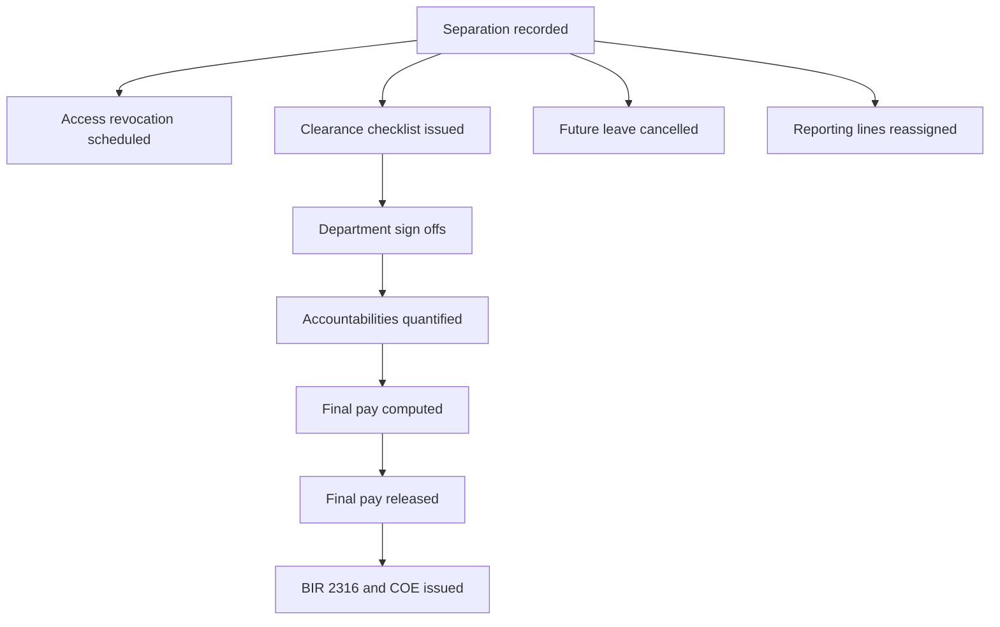

# Offboarding and Clearance

## Purpose

Close out an employment relationship correctly: capture the separation, run clearance across every department that holds an accountability, compute and release final pay, revoke access, and issue the documents the employee is entitled to.

Offboarding is where several modules must agree, and where getting it wrong is expensive in both directions — releasing final pay before clearance loses company assets; delaying it past the statutory window exposes the company to a labour complaint.

## Scope

### In scope

- Separation types and reasons, with notice tracking
- Resignation letters and acceptance
- Exit interview capture
- Clearance checklist per department with sign-off
- Accountability quantification: cash advances, unreturned assets, training bonds, loan balances
- Asset return tracking
- Final pay computation handover to [[Payroll]]
- Access revocation and session termination
- Document issuance: certificate of employment, BIR 2316, clearance certificate
- Reporting-line reassignment for the departing employee's reports
- Turnover data for [[Reports-and-Analytics]]

### Out of scope

- Final pay arithmetic → [[Payroll]] (this module supplies accountabilities and the clearance gate)
- Leave conversion computation → [[Leave-Management]]
- Disciplinary process leading to termination → HR policy, outside the system in MVP
- Retirement benefit computation → needs its own spec if applicable

## Key Entities

| Entity | Purpose | Notable fields |
|---|---|---|
| `separations` | The separation event. | `id`, `employee_id`, `separation_type` (`RESIGNATION`/`END_OF_CONTRACT`/`TERMINATION`/`RETIREMENT`/`REDUNDANCY`/`DEATH`/`ABANDONMENT`), `reason_code`, `reason_detail`, `notice_given_at`, `last_working_date`, `effective_separation_date`, `is_eligible_for_rehire`, `status` (`INITIATED`/`CLEARANCE`/`FINAL_PAY_PENDING`/`COMPLETED`/`CANCELLED`), `recorded_by`, `approved_by` |
| `separation_documents` | Resignation letter, termination notice, acceptance. | `separation_id`, `document_type`, `file_path`, `uploaded_at` |
| `exit_interviews` | Structured exit feedback. | `separation_id`, `conducted_by`, `conducted_at`, `responses_json`, `primary_reason_code`, `would_recommend`, `comments` |
| `clearance_checklists` | One per separation. | `id`, `separation_id`, `template_id`, `issued_at`, `target_complete_at`, `status` |
| `clearance_items` | One sign-off per responsible department. | `checklist_id`, `department_id`, `item_name`, `responsible_employee_id`, `status` (`PENDING`/`CLEARED`/`WITH_ACCOUNTABILITY`), `accountability_amount`, `remarks`, `signed_off_by`, `signed_off_at` |
| `clearance_templates` | Reusable item sets. | `id`, `name`, `applies_to_department_id`, `active` |
| `employee_assets` | Issued company property. | `id`, `employee_id`, `asset_tag`, `description`, `issued_at`, `returned_at`, `condition_on_return`, `replacement_cost`, `status` |
| `accountabilities` | Anything owed to the company at separation. | `id`, `separation_id`, `source_type` (`ASSET`/`CASH_ADVANCE`/`LOAN_BALANCE`/`TRAINING_BOND`/`OTHER`), `source_ref_id`, `amount`, `is_waived`, `waived_by`, `waiver_reason` |
| `separation_documents_issued` | What was given to the employee. | `separation_id`, `document_type` (`COE`/`BIR_2316`/`CLEARANCE_CERT`/`QUITCLAIM`), `issued_at`, `issued_by`, `file_path`, `acknowledged_at` |

## Core Flows

### Flow 1 — Record a separation

1. HR admin records the separation: type, reason, notice date, last working date, effective separation date.
2. For a resignation, the letter is attached and the notice period is checked against policy; a shortfall is flagged, not blocked, since it may be waived.
3. On save, in one transaction:
   - `employees.separation_date` is set and a status-history row closes the active employment status.
   - Future-dated approved leave is cancelled in [[Leave-Management]], restoring balance.
   - Employees reporting to the departing employee are listed for reassignment and the separation cannot complete until they are reassigned.
   - Access revocation is scheduled for the effective date via [[Auth-and-RBAC]] (BR-120).
   - A clearance checklist is issued from the matching template.
4. [[Notifications]] informs each clearance signatory and the departing employee's manager.

### Flow 2 — Clearance

1. Each responsible department sees its clearance items in its queue.
2. The signatory marks `CLEARED`, or `WITH_ACCOUNTABILITY` with an amount and remarks — e.g. an unreturned laptop at replacement cost.
3. Asset return is recorded against `employee_assets` with the condition on return; a damaged asset may carry a partial accountability.
4. Open loan balances and cash advances are pulled automatically from [[Payroll]] rather than retyped.
5. An accountability may be waived by an authorised approver, with a reason, which is audited.
6. The checklist completes only when every item is `CLEARED` or has a quantified accountability.

### Flow 3 — Final pay

1. Once clearance is complete, the separation moves to `FINAL_PAY_PENDING` and [[Payroll]] may create a `FINAL_PAY` run.
2. The run computes unpaid salary to the last working date, pro-rated 13th month, cash conversion of unused convertible leave, and any tax true-up, less the total unwaived accountabilities.
3. Release is blocked while clearance is incomplete (US-811, BR-811).
4. A negative final pay — accountabilities exceeding entitlements — must not produce a negative payslip; it produces a receivable and a documented demand. BR-507 still applies.

> [!warning] NEEDS VERIFICATION
> There is a prescribed period within which final pay must be released after separation, and a prescribed period for issuing the certificate of employment, set by DOLE issuance. Confirm both and configure them as the SLA the system tracks and warns on. Do not guess the number of days.

### Flow 4 — Documents and closure

1. BIR 2316 for the partial year is generated by [[Reports-and-Analytics]].
2. A certificate of employment is generated on request, stating the facts of employment only.
3. A clearance certificate and, if used, a quitclaim are issued and acknowledgement recorded.
4. Separation status becomes `COMPLETED`. The employee record is archived but never deleted — payroll history, 2316 reissue requests and rehire checks all need it.

### Flow 5 — Exit interview

1. HR conducts the exit interview and records structured responses plus a primary reason code.
2. Reason codes aggregate into the turnover analysis in [[Reports-and-Analytics]].
3. Free-text comments are restricted in visibility — they frequently name managers.

## Business Rules

- **BR-810** — An employee's record is archived on separation, never deleted. BR-224 still applies.
- **BR-811** — Final pay may not be released while any clearance item is `PENDING`.
- **BR-812** — Accountabilities are deducted from final pay unless explicitly waived by an authorised approver, with the waiver audited.
- **BR-813** — A separation cannot complete while employees still report to the departing employee.
- **BR-814** — Future-dated approved leave is cancelled on separation, restoring the leave balance.
- **BR-815** — System access is revoked and all sessions terminated on the effective separation date, not later.
- **BR-816** — An employee separated mid-cut-off is paid for that cut-off exactly once, in either the regular run or the final pay run.
- **BR-817** — Rehire creates a new employee record; tenure, leave accrual and 13th month restart.
- **BR-818** — Final pay net may not be negative; a shortfall becomes a receivable.

## Functional Requirements

| ID | Requirement | Priority |
|---|---|---|
| FR-830 | The system shall record a separation with type, reason, notice date, last working date and effective date. (US-810) | Should |
| FR-831 | The system shall attach separation documents such as a resignation letter or termination notice. | Should |
| FR-832 | The system shall flag a notice period shorter than policy without blocking the separation. | Could |
| FR-833 | The system shall issue a clearance checklist from a template on separation. (US-810) | Should |
| FR-834 | The system shall allow each responsible department to sign off its clearance items as cleared or with a quantified accountability. | Should |
| FR-835 | The system shall track issued company assets and their return with condition. | Should |
| FR-836 | The system shall pull outstanding loan and cash advance balances from payroll into accountabilities automatically. | Should |
| FR-837 | The system shall allow an authorised approver to waive an accountability with a reason, audited. (BR-812) | Should |
| FR-838 | The system shall block final pay release while any clearance item is pending. (US-811, BR-811) | Should |
| FR-839 | The system shall cancel future-dated approved leave on separation and restore the balance. (BR-814) | Must |
| FR-840 | The system shall require reassignment of the departing employee's direct reports before completion. (BR-813) | Should |
| FR-841 | The system shall revoke system access and terminate all sessions on the effective separation date. (BR-815) | Must |
| FR-842 | The system shall capture a structured exit interview with a primary reason code feeding turnover analysis. | Could |
| FR-843 | The system shall generate a certificate of employment on request. | Should |
| FR-844 | The system shall track and warn on the statutory SLA for final pay release and COE issuance. | Should |
| FR-845 | The system shall issue a clearance certificate and record the employee's acknowledgement. | Could |
| FR-846 | The system shall archive the employee record on completion without deleting any data. (BR-810) | Must |
| FR-847 | The system shall prevent a negative final pay net, recording any shortfall as a receivable. (BR-818) | Must |
| FR-848 | The system shall audit every separation and clearance state change. | Must |
| FR-849 | The system shall restrict visibility of exit interview free-text comments to authorised roles. | Should |

## Edge Cases

| Case | Expected handling |
|---|---|
| Employee abandons the post (AWOL) | No last working date from the employee; HR sets it from the last attendance record. Separation type `ABANDONMENT`. Clearance proceeds without their participation. |
| Employee dies in service | Separation type `DEATH`. Final pay goes to the recorded beneficiary from [[Employee-Records]], which is why dependents and beneficiaries are captured. Handle with care in the UI. |
| Resignation withdrawn before the effective date | Separation `CANCELLED`, status history reopened, scheduled access revocation cancelled, leave restored. Must be reversible. |
| Clearance stalls on one unresponsive department | SLA warning plus escalation. An override by HR head is possible but must be audited; otherwise final pay is held hostage. |
| Accountability exceeds final pay | Net floors at zero; the remainder is a documented receivable. BR-818. |
| Separation after the DTR is locked but before payroll release | Paid in the regular run to the last working date; final pay run covers only the remaining components. BR-816. |
| Separated employee requests a reissued 2316 years later | Archived record plus released payroll history makes this possible. This is the main reason records are never deleted. |
| Employee separated then rehired within the same year | New employee record; the 13th month computation must consider the two periods per the governing rule. Flag for verification. |
| Manager separating with pending approvals | Reassigned up the chain; orphan check in [[Org-Structure]] surfaces leftovers. |
| Employee refuses to sign the clearance or quitclaim | Record the refusal; release of final pay should not be conditioned on a quitclaim signature. Note this as a policy/legal question. |
| Asset returned damaged | Partial accountability at a documented cost, not the full replacement cost by default. |

## Open Questions

- [ ] What is the statutory window for final pay release and COE issuance? → NEEDS VERIFICATION above
- [ ] Which departments sign clearance, and what does each check?
- [ ] Who may waive an accountability, and up to what amount?
- [ ] Is a quitclaim used, and is final pay conditioned on it? (legal question, not technical)
- [ ] Is retirement benefit computation in scope?
- [ ] Are company assets tracked today, and if so where? (affects whether `employee_assets` is new or an import)
- [ ] Is rehire eligibility recorded and enforced at application?

## Related

[[Employee-Records]] · [[Payroll]] · [[Leave-Management]] · [[Auth-and-RBAC]] · [[Org-Structure]] · [[Reports-and-Analytics]] · [[Notifications]] · [[Recruitment-and-Onboarding]] · [[Security-and-Compliance]] · [[Business-Rules]] · [[Data-Model]] · [[Screens]] · [[PH-Labor-and-Payroll-Notes]]
