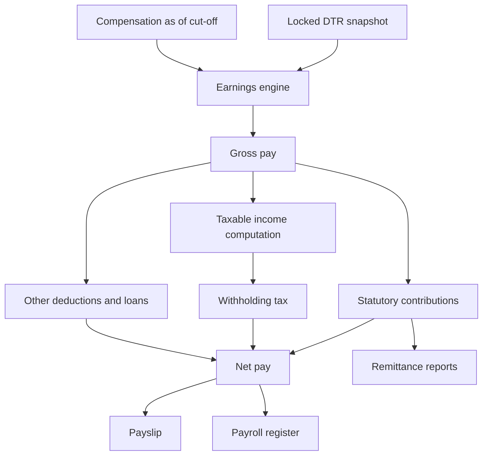

# Payroll

## Purpose

Turn a locked DTR plus an employee's compensation into a payslip, a register, and a set of statutory obligations — reproducibly. This is the module the whole system exists for and the one where a bug costs real money and real trust.

One property dominates every design decision here:

> [!note] The reproducibility invariant
> **A released payroll run must be recomputable at any future date and produce identical figures.** This is only possible if the run stores (a) a snapshot of its inputs, and (b) the *version* of every rate table and rule it used. A run that reads live employee and rate data is not reproducible, because both change. Everything below follows from this.

The second principle: **payroll never computes hours.** [[Attendance-and-DTR]] produces hours; payroll converts hours to pesos. Keeping that line clean is what makes both modules testable.

## Scope

### In scope

- Payroll periods and cut-off calendar
- Payroll run lifecycle: draft → computed → reviewed → released, with reversal
- Employee inclusion and exclusion with reasons
- Rate derivation: monthly/daily/hourly basis, daily rate, hourly rate, divisors
- Earnings: basic pay, overtime, night differential, holiday pay, rest-day premium, allowances, paid leave, 13th month, cash conversions, one-off earnings
- Deductions: statutory (SSS, PhilHealth, Pag-IBIG), withholding tax, loans with amortisation, tardiness/undertime/absence, one-off deductions
- Employer-share computation for statutory contributions
- Taxability classification, including de minimis treatment
- Payslip generation and release
- Payroll register and run reconciliation
- Final pay computation
- Adjustments against released runs
- Payroll journal export for accounting
- Rate table configuration with effectivity dating

### Out of scope

- Hours derivation → [[Attendance-and-DTR]]
- Leave entitlement and balance → [[Leave-Management]]
- Government report file formats → [[Reports-and-Analytics]]
- General ledger posting → an export only, per [[Vision-and-Scope]]
- Bank payment file → deferred, US-515
- Compensation approval workflow → [[Employee-Records]]

## Pay model

### Rate derivation

Everything downstream depends on getting the daily and hourly rate right, and this is where PH payroll disputes concentrate.

| Pay basis | Daily rate | Hourly rate | Unworked holiday |
|---|---|---|---|
| **Monthly-paid** | monthly basic × 12 ÷ annual factor | daily rate ÷ hours per day | Already included in the monthly salary; a regular holiday not worked is *not* additionally paid |
| **Daily-paid** | the stated daily rate | daily rate ÷ hours per day | Paid separately as holiday pay if the qualifying condition is met |
| **Hourly-paid** | hourly rate × hours per day | the stated hourly rate | Per policy and statute |

> [!warning] NEEDS VERIFICATION
> The **annual factor / divisor** (the number of paid days per year used to convert a monthly salary into a daily rate) depends on whether the employee is paid for rest days and holidays, and several standard factors exist for different arrangements. It is both a legal and a company-policy question. Do not hardcode a divisor. Make it a per-employee or per-employment-type config field, document which factor was chosen and why, and confirm the choice against the DOLE handbook. Choosing wrongly makes every overtime and holiday figure wrong by a constant percentage — and nobody notices for months.

> [!warning] NEEDS VERIFICATION
> Overtime multipliers, rest-day premium, special non-working day premium, regular holiday pay, double-holiday pay, the night differential percentage and the night window are all statutory. Every one is referenced in [[Business-Rules]] as a *named config row*, never as a literal in this vault. Confirm against the Labor Code and the current DOLE Handbook on Workers' Statutory Monetary Benefits before coding.

### Statutory contributions

| Contribution | Mechanism | Base |
|---|---|---|
| **SSS** | Bracketed contribution schedule. The employee's monthly compensation maps to a Monthly Salary Credit bracket; the schedule gives the employee share, employer share and, above a threshold, a provident-fund component. | Monthly compensation, bracketed |
| **PhilHealth** | Percentage of monthly basic salary, bounded by a floor and a ceiling, shared between employee and employer. | Monthly basic salary |
| **Pag-IBIG** | Percentage of monthly compensation, with a different employee rate below and above a salary threshold, and a compensation cap on the computation. | Monthly compensation, capped |
| **Withholding tax** | Progressive bracket table applied to taxable compensation for the payroll frequency in use. | Taxable compensation for the period |

> [!warning] NEEDS VERIFICATION
> Every bracket, rate, floor, ceiling, cap, threshold and schedule above changes by agency circular — SSS, PhilHealth and Pag-IBIG have all changed within recent years, and BIR tables changed under the TRAIN schedule. **No figure for any of them appears anywhere in this vault.** Each must be entered as effectivity-dated config rows by a human who read the current circular, with the circular number and effectivity date recorded. See Q22–Q26 in [[Open-Questions]] and [[PH-Labor-and-Payroll-Notes]].

### Semi-monthly problem

Statutory contributions are **monthly** amounts, but many PH employers pay semi-monthly. Three viable strategies, and the choice must be explicit:

1. **Full deduction in one cut-off** — deduct the whole monthly contribution in, say, the second cut-off. Simple, but the two payslips differ noticeably.
2. **Split in half** — deduct half in each cut-off. Smoother, but rounding must reconcile to the exact monthly total.
3. **Compute monthly, true up** — compute on projected monthly compensation, deduct per period, and reconcile at month end.

Whichever is chosen, the invariant is: **the sum of per-period deductions must equal the monthly contribution due for remittance.** Otherwise [[Reports-and-Analytics]] remittance reports will not tie to payroll. This belongs in [[ADR-003-Payroll-Engine-Approach]].

## Key Entities

| Entity | Purpose | Notable fields |
|---|---|---|
| `payroll_periods` | The cut-off calendar. | `id`, `company_id`, `period_code`, `frequency` (`SEMI_MONTHLY`/`MONTHLY`/`WEEKLY`), `cutoff_from`, `cutoff_to`, `pay_date`, `tax_month`, `status` (`OPEN`/`DTR_LOCKED`/`PAYROLL_RELEASED`/`CLOSED`) |
| `payroll_runs` | One computation over one period. Several may exist: regular, special, 13th month, final pay. | `id`, `payroll_period_id`, `run_type` (`REGULAR`/`SPECIAL`/`THIRTEENTH_MONTH`/`FINAL_PAY`/`ADJUSTMENT`), `status` (`DRAFT`/`COMPUTED`/`REVIEWED`/`RELEASED`/`VOIDED`), `dtr_lock_id`, `rate_table_version_set`, `computed_at`, `computed_by`, `released_at`, `released_by`, `total_gross`, `total_deductions`, `total_net`, `employee_count` |
| `payroll_run_employees` | Per-employee result header. | `id`, `payroll_run_id`, `employee_id`, `inclusion_reason`, `compensation_snapshot_json`, `gross_pay`, `taxable_income`, `total_deductions`, `net_pay`, `status` |
| `payroll_earnings` | One row per earning line. | `payroll_run_employee_id`, `earning_type_id`, `quantity`, `rate`, `amount`, `is_taxable`, `source_reference` |
| `payroll_deductions` | One row per deduction line. | `payroll_run_employee_id`, `deduction_type_id`, `basis_amount`, `rate_or_bracket_ref`, `amount`, `employer_share`, `source_reference` |
| `earning_types` | Master. | `code`, `name`, `category` (`BASIC`/`PREMIUM`/`ALLOWANCE`/`BENEFIT`/`ONE_OFF`), `is_taxable_default`, `is_de_minimis`, `de_minimis_ceiling_ref`, `include_in_13th_month`, `include_in_statutory_base` |
| `deduction_types` | Master. | `code`, `name`, `category` (`STATUTORY`/`TAX`/`LOAN`/`PENALTY`/`ONE_OFF`), `has_employer_share`, `reduces_taxable_income` |
| `rate_tables` | A named, versioned statutory table. | `id`, `table_code` (`SSS`/`PHILHEALTH`/`PAGIBIG`/`BIR_WITHHOLDING`), `version_label`, `effective_from`, `effective_to`, `source_reference`, `entered_by`, `verified_by`, `verified_at` |
| `rate_table_rows` | The bracket rows. | `rate_table_id`, `bracket_from`, `bracket_to`, `fixed_amount`, `rate_percent`, `employee_share`, `employer_share`, `extra_json` |
| `employee_loans` | Amortising obligations. | `id`, `employee_id`, `loan_type` (`SSS_SALARY`/`SSS_CALAMITY`/`PAGIBIG_MPL`/`COMPANY_ADVANCE`), `principal`, `amortisation_amount`, `start_period_id`, `balance`, `status` |
| `payroll_adjustments` | Corrections against a released run. | `id`, `original_payroll_run_id`, `applied_in_run_id`, `employee_id`, `adjustment_type`, `amount`, `reason`, `approved_by` |
| `payslips` | The issued document. | `payroll_run_employee_id`, `payslip_no`, `released_at`, `pdf_path`, `viewed_at`, `ytd_snapshot_json` |
| `thirteenth_month_computations` | Working detail per employee per year. | `employee_id`, `year`, `basic_earned_total`, `months_counted`, `amount`, `taxable_portion`, `run_id` |
| `final_pay_computations` | Separation settlement detail. | `employee_id`, `separation_date`, `unpaid_salary`, `prorated_13th`, `leave_conversion`, `accountabilities`, `tax_adjustment`, `net_amount`, `clearance_id` |

## Core Flows

### Flow 1 — Open a payroll period

1. Sys admin generates the year's `payroll_periods` from the configured frequency and cut-off pattern.
2. Each period gets a `tax_month`, which may differ from the cut-off month when the pay date falls in the following month — this determines which monthly contribution and tax month the amounts belong to.
3. Period status starts `OPEN`.

### Flow 2 — Run regular payroll

1. Payroll officer confirms the DTR for the period is locked in [[Attendance-and-DTR]]; otherwise the run cannot be created (BR-501).
2. Creates a run. System determines inclusion: active employees with a placement and compensation covering the cut-off, who are payroll-ready per BR-202. Each inclusion and each *exclusion* carries a reason, shown on screen (US-501).
3. For each included employee, the system snapshots their compensation, placement and exemption flags into `compensation_snapshot_json`. From this point the run does not read live employee data.
4. The run records the `rate_table_version_set` — the exact version IDs of SSS, PhilHealth, Pag-IBIG and BIR tables effective on the pay date.
5. **Earnings pass**: derive daily and hourly rate; compute basic pay from DTR hours and day types; compute OT, night differential, holiday and rest-day premiums; add recurring allowances; add paid leave; deduct for tardiness, undertime and absence per policy; add one-off earnings. Each produces a `payroll_earnings` row with quantity, rate and source reference.
6. **Statutory pass**: compute SSS, PhilHealth and Pag-IBIG from the snapshotted tables, applying the semi-monthly strategy. Record both employee and employer share.
7. **Tax pass**: compute taxable income as gross less non-taxable earnings less statutory employee contributions less de minimis amounts within ceiling; apply the withholding table for the frequency.
8. **Other deductions pass**: loan amortisations (capped at outstanding balance), penalties, one-off deductions.
9. Net pay = gross − total employee deductions. Status becomes `COMPUTED`.
10. Validation gate runs: no negative net pay, every employee has a basic earning line, register totals foot, no employee included twice, statutory sums reconcile to monthly expectations.

### Flow 3 — Review and release

1. Payroll officer opens the register (SCR-510): one row per employee, columns for each earning and deduction, with totals that must foot.
2. Drill-down: net pay → deduction/earning line → DTR day → session → raw punch (US-506, FR-506). This is the trust-building feature; it is not optional.
3. Variance report compares each employee against the previous run and flags anything beyond a threshold — the fastest way to catch a wrong rate or a missing punch.
4. Officer marks the run `REVIEWED`. A second role may be required to release, per separation of duties in [[Personas]].
5. On release: status `RELEASED`, payslips generated with a payslip number and a YTD snapshot, period status becomes `PAYROLL_RELEASED`, loan balances decrement, leave conversions post, and [[Notifications]] informs employees.
6. From release onward the run is **immutable** (BR-508).

### Flow 4 — Reverse or void an unreleased run

1. While status is `DRAFT`, `COMPUTED` or `REVIEWED`, the run may be voided.
2. Voiding deletes nothing: the run is marked `VOIDED` with a reason and its result rows are retained for inspection.
3. A new run may then be created on the same period. Loan balances and leave ledger entries are untouched because they only post on release.

### Flow 5 — Correct a released run

1. Released runs are immutable. A correction creates a `payroll_adjustments` row.
2. The adjustment is applied in a nominated later run, with its reason and approver.
3. The payslip for the later period shows the adjustment as its own line referencing the original period, so the employee can see what was corrected.
4. Alternative — void and reissue the payslip — is the other option; this is a real decision, pending as ADR-009. Q9 in [[Open-Questions]].

### Flow 6 — 13th month pay

1. HR/payroll triggers a 13th-month run for the year.
2. For each employee, sum the **basic salary actually earned** during the calendar year from released regular runs — excluding earning types flagged `include_in_13th_month = false`, which typically excludes OT, allowances and premiums.
3. Compute the benefit per the statutory formula, pro-rated for employees with less than a full year of service.
4. Classify the taxable portion: 13th month plus other benefits is exempt up to a ceiling, and the excess is taxable.
5. Review, release, and pay on or before the statutory deadline.

> [!warning] NEEDS VERIFICATION
> The 13th month formula's divisor, what counts as "basic salary earned", the pro-rating rule for partial-year service, the tax-exempt ceiling for 13th month plus other benefits, and the payment deadline are all statutory. Confirm each against the governing Presidential Decree, its implementing rules and current BIR regulations before coding.

### Flow 7 — Final pay

1. [[Offboarding-and-Clearance]] marks clearance as complete or quantifies the outstanding accountabilities.
2. A `FINAL_PAY` run computes: unpaid salary up to the separation date, pro-rated 13th month, cash conversion of unused convertible leave from [[Leave-Management]], less accountabilities, less any tax true-up.
3. Release is blocked until clearance is resolved (US-811).
4. BIR 2316 for the employee's partial year is generated by [[Reports-and-Analytics]].

### Flow 8 — Configure a rate table

1. Sys admin reads the agency circular, then enters a new `rate_tables` version with `effective_from` and the circular as `source_reference`.
2. Enters bracket rows.
3. A **second** person verifies and sets `verified_by` / `verified_at`. An unverified table cannot be used by a run (BR-514) — this is the control that stops a typo becoming 300 wrong payslips.
4. The previous version's `effective_to` is closed automatically with no gap or overlap.

## Business Rules

See [[Business-Rules]] for full statements. Payroll-critical ones:

- **BR-501** — A payroll run may only be created against a locked DTR snapshot, and reads only that snapshot.
- **BR-502** — A run snapshots employee compensation, placement and flags at creation; it never reads live employee data thereafter.
- **BR-503** — A run records the exact version of every rate table it used, and recomputation uses those versions, not current ones.
- **BR-504** — Daily and hourly rate derivation uses the employee's pay basis and configured annual factor. Never a hardcoded divisor.
- **BR-505** — Gross pay is the sum of earning lines; net pay is gross less employee-share deductions. Employer share is never deducted from the employee.
- **BR-506** — Taxable income excludes non-taxable earning types, employee statutory contributions, and de minimis amounts within their ceiling. Amounts above a de minimis ceiling are taxable.
- **BR-507** — Net pay must not be negative. If deductions exceed gross, the excess carries forward as a balance rather than producing a negative payslip.
- **BR-508** — A released run is immutable. Corrections are dated adjustments in a later run.
- **BR-509** — The sum of per-period statutory deductions within a month must equal the monthly contribution due for remittance.
- **BR-510** — Loan amortisation is capped at the outstanding balance; the final instalment is the remainder, not the standard amount.
- **BR-511** — An employee appears at most once per run per run type.
- **BR-512** — Monetary computation is performed at four decimal places and rounded to two only on presentation and payment; the rounding difference must be accounted for, not dropped.
- **BR-513** — 13th month base includes only earning types flagged as included; OT and allowances are excluded by default.
- **BR-514** — An unverified rate table version cannot be used by a payroll run.
- **BR-515** — Statutory contributions are computed on the employee's monthly compensation, not on a single cut-off's gross, even when paid semi-monthly.

## Functional Requirements

| ID | Requirement | Priority |
|---|---|---|
| FR-501 | The system shall generate payroll periods from a configured frequency and cut-off pattern, each with a cut-off range, pay date and tax month. (Q4) | Must |
| FR-502 | The system shall create a payroll run only against a locked DTR snapshot. (US-501, BR-501) | Must |
| FR-503 | The system shall list included and excluded employees for a run with a reason for each. (US-501) | Must |
| FR-504 | The system shall snapshot each included employee's compensation, placement and exemption flags into the run. (BR-502) | Must |
| FR-505 | The system shall record the version of every rate table used by a run. (BR-503) | Must |
| FR-506 | The system shall compute basic pay, overtime, night differential, holiday pay and rest-day premium from the locked DTR and the applicable day types. (US-502) | Must |
| FR-507 | The system shall derive daily and hourly rates from the employee's pay basis and configured annual factor. (BR-504) | Must |
| FR-508 | The system shall compute SSS, PhilHealth and Pag-IBIG employee and employer shares from effectivity-dated versioned rate tables. (US-503) | Must |
| FR-509 | The system shall compute withholding tax using the bracket table for the payroll frequency in use. (US-504) | Must |
| FR-510 | The system shall apply a configurable strategy for allocating monthly statutory contributions across semi-monthly periods, such that the monthly total is exact. (BR-509) | Must |
| FR-511 | The system shall classify each earning type as taxable, non-taxable or de minimis with a ceiling, and shall tax only the excess above a de minimis ceiling. (US-517, BR-506) | Should |
| FR-512 | The system shall support one-off earnings and deductions per employee per run. (US-510) | Must |
| FR-513 | The system shall support recurring loans with amortisation and a decrementing balance, capping the final instalment at the remaining balance. (US-511, BR-510) | Should |
| FR-514 | The system shall deduct for tardiness, undertime and absence per configured policy. | Must |
| FR-515 | The system shall produce a payroll register whose totals foot, and shall block release if they do not. (US-505) | Must |
| FR-516 | The system shall allow drill-down from net pay to earning line to DTR day to raw punch. (US-506) | Must |
| FR-517 | The system shall produce a variance report comparing each employee against the previous run, flagging outliers. | Should |
| FR-518 | The system shall void an unreleased run without deleting its data and without side effects on loans or the leave ledger. (US-507) | Must |
| FR-519 | The system shall make a released run immutable and shall record corrections as dated adjustments applied in a later run. (US-508, BR-508) | Must |
| FR-520 | The system shall generate a numbered payslip per employee per run, with YTD figures, and release it to the portal. (US-509) | Must |
| FR-521 | The system shall recompute a past run from its snapshots and recorded table versions and shall report any difference from the stored result. (US-514) | Must |
| FR-522 | The system shall prevent negative net pay, carrying the excess forward as a balance. (BR-507) | Must |
| FR-523 | The system shall compute 13th month pay as a separate run with a configurable inclusion set and a taxable-portion split. (US-512) | Should |
| FR-524 | The system shall compute final pay including unpaid salary, pro-rated 13th month, leave conversion and accountabilities, blocked until clearance is resolved. (US-513, US-811) | Should |
| FR-525 | The system shall require a second person to verify a rate table version before a run may use it. (BR-514) | Must |
| FR-526 | The system shall export a payroll journal grouped by cost center for the accounting system. (US-609) | Should |
| FR-527 | The system shall audit every run state transition, adjustment and rate table change with actor and timestamp. | Must |
| FR-528 | The system shall support a payroll run restricted to a subset of employees for special or off-cycle payments. | Should |
| FR-529 | The system shall support year-end tax annualisation producing a refund or additional withholding. (US-516) | Could |
| FR-530 | The system shall prevent the same user from both computing and releasing a run where separation of duties is enabled. | Should |

## Edge Cases

| Case | Expected handling |
|---|---|
| Employee hired mid-cut-off | Basic pay prorated from the hire date. Statutory contributions still computed on monthly compensation per BR-515, which may mean a full monthly contribution on a partial salary — a known and correct oddity. |
| Employee separated mid-cut-off | Paid to the separation date in the regular run or in the final pay run, never both. |
| Mid-cut-off salary increase | Two compensation rows; prorate by effectivity date. Test this explicitly — it is the most commonly wrong case. |
| Employee with zero hours in the cut-off | Must appear in the included list with zero gross, not silently dropped, so the officer sees it. Monthly-paid employees with zero attendance need an explicit policy answer. |
| Deductions exceed gross | Net floors at zero; the shortfall becomes a carried-forward balance. BR-507. |
| Employee on unpaid leave for the entire cut-off | Zero gross. Statutory contributions on zero compensation need an explicit rule — typically no contribution, but confirm. |
| Maternity salary differential | Paid by the employer as an earning; the SSS reimbursement is a company receivable and must not appear as employee pay. |
| Employee with two active loans | Both amortise. If combined amortisation would make net negative, apply a configured priority order and defer the rest. |
| Rate table changes mid-month | The run uses the table effective on the **pay date** per BR-503. Document this choice; the alternative (cut-off date) is defensible but must be consistent. |
| Retroactive statutory rate change | Released runs stay as released. The differential becomes an adjustment. Never recompute a released run into new numbers. |
| 13th month for an employee who resigned mid-year | Pro-rated in the final pay run, not in the December run. |
| Employee paid in a different currency or abroad | Out of scope. Reject at inclusion rather than computing something wrong. |
| Rounding across 300 employees | Four-decimal computation, two-decimal presentation, and the register's sum of rounded values must be reconciled to the rounded sum of values. BR-512. |
| Duplicate payroll run created by accident | BR-511 plus a unique constraint on `(period, run_type, employee)` for non-voided runs. |
| Payslip released then an employee disputes a punch | Dispute becomes an adjustment. The released payslip stands. This is why employees must see their DTR *before* lock (FR-314). |
| Tax annualisation producing a refund | Negative tax line in the December run, which must not break the negative-net check. |

## Open Questions

- [ ] Cut-off pattern and pay dates, and whether they differ by employee group? → Q4 in [[Open-Questions]]
- [ ] Monthly-paid, daily-paid, or both? And which annual factor / divisor applies to each? → Q8
- [ ] Which semi-monthly statutory allocation strategy?
- [ ] Which allowances exist, and which are de minimis? → Q12
- [ ] Are loans tracked with amortisation here or deducted as flat amounts? → Q11
- [ ] Corrections after release: adjustment or void-and-reissue? → Q9, needs ADR-009
- [ ] What must appear on the payslip, including YTD and employer share? → Q10
- [ ] Is tardiness actually deducted from pay?
- [ ] Is separation of duties between compute and release enforced, given a small team?
- [ ] Is prior-employer income from a BIR 2316 captured for mid-year hires, for correct annualisation?

## Related

[[Attendance-and-DTR]] · [[Leave-Management]] · [[Employee-Records]] · [[Org-Structure]] · [[Reports-and-Analytics]] · [[Self-Service-Portal]] · [[Offboarding-and-Clearance]] · [[Business-Rules]] · [[Data-Model]] · [[API-Surface]] · [[Screens]] · [[Security-and-Compliance]] · [[ADR-003-Payroll-Engine-Approach]] · [[PH-Labor-and-Payroll-Notes]] · [[Glossary]] · [[Notifications]]
