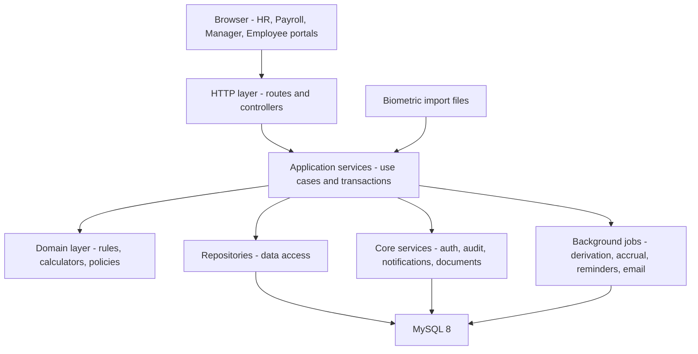
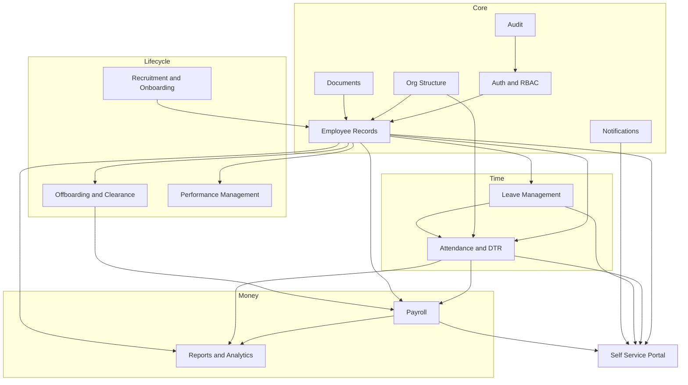
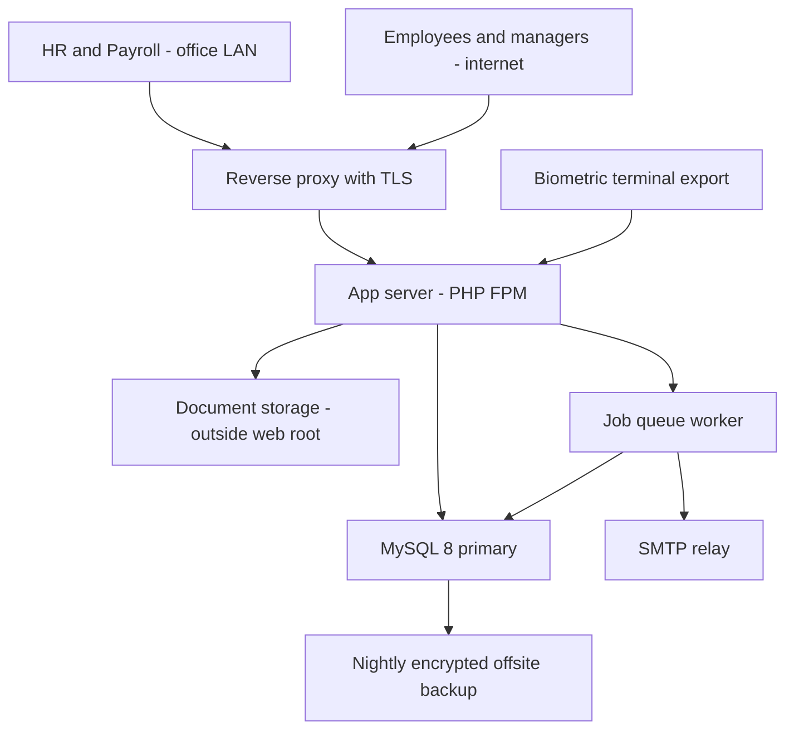

# Architecture

## Purpose

How the system is structured, where logic lives, and how it is deployed. The stack itself is an open decision — see [[ADR-001-Tech-Stack]] — but the *shape* below holds regardless of which stack wins, and that is deliberate: committing to the shape now means the stack decision does not block [[Build-Plan]].

## Context

This is **brownfield**. A working PHP 8.2 / MySQL 8 modular monolith already exists with recruitment, employee directory, attendance import and parts of payroll implemented, running locally on XAMPP. Any architecture proposal that ignores this is a fantasy. The realistic options are consolidate-and-extend or a staged rewrite — not a blank page.

## Architectural style: modular monolith

One deployable application, internally partitioned by domain module with enforced boundaries.

**Why, specifically here:**

- One developer plus Claude Code. Microservices would spend the entire budget on infrastructure that solves a problem this system does not have.
- The domain is highly cohesive. Payroll cannot be computed without attendance, employees, leave and org data. Splitting these across services would mean distributed transactions in the one place correctness matters most.
- Load is ~300 employees, a few concurrent HR users, and a payroll run twice a month. A single modest server is over-provisioned.
- Modules can be extracted later if scale or organisation ever justifies it. The boundary discipline below is what keeps that possible.

**What "modular" has to mean to be real:**

1. Each module owns its tables. No other module writes them.
2. Cross-module reads go through the owning module's service interface, not by joining its tables.
3. Shared concerns — auth, audit, notifications, documents, org masters — are core services, not copies.
4. Business rules live in the domain layer, server-side. Never only in JavaScript. (Inherited rule from the existing codebase, and the right one.)
5. Controllers and routes are thin; they parse, authorise, delegate, and render.

## Layers

| Layer | Responsibility | Must not |
|---|---|---|
| HTTP | Parse input, check permission and scope, delegate, render | Contain business rules |
| Application services | One use case per method, own the transaction boundary, emit events after commit | Know about HTTP or SQL |
| Domain | Pure computation: payroll calculator, DTR deriver, accrual engine, rule evaluation | Touch the database |
| Repositories | Data access, scope filtering | Contain business rules |
| Core services | Auth, audit, notifications, document storage, org masters | Be duplicated per module |
| Background jobs | DTR derivation, accrual runs, reminders, email queue, report generation | Be the only path to a result a user can trigger |

The layer that earns its keep is **domain**. `PayrollCalculator` and `DtrDeriver` must be pure functions of their inputs, with no database access, because that is the only way the reproducibility invariant in [[Payroll]] is testable. Give them inputs, assert outputs, run hundreds of cases in milliseconds.

## Module map

Dependency direction is strictly one-way: **Core → Time → Money**. [[Payroll]] depends on [[Attendance-and-DTR]]; attendance must never depend on payroll. A cycle here is a design defect, and it is worth a lint rule.

## Stack decision

Open. Full analysis in [[ADR-001-Tech-Stack]]; the summary:

| Option | For | Against |
|---|---|---|
| **A. Consolidate on existing PHP 8.2 + MySQL 8** | Working code already exists; John knows it; zero migration; XAMPP deployment already proven | Vanilla PHP means hand-rolling routing, migrations, ORM, queues, templating; testing discipline is harder to retrofit |
| **B. PHP + Laravel, same MySQL** | Keeps the language, the database and most domain code; gets migrations, queues, auth scaffolding, Eloquent, a real test harness; large PH developer pool | A genuine refactor of the existing app; framework conventions to learn |
| **C. Rewrite in TypeScript / Node, or Python / Django** | Modern tooling, strong typing (TS), excellent testing | Discards working code; new language risk on a compliance-critical system; XAMPP deployment assumption breaks |

**Recommendation: B.** It keeps the asset that matters — working, domain-correct PHP and a MySQL schema that already models recruitment and attendance — while buying the three things the project most needs: **migrations, a job queue, and a test harness**. Payroll correctness depends on being able to run hundreds of calculator tests cheaply, and that is painful to build from nothing. Option A is defensible if time pressure is severe; it just means accepting that migrations and queues get hand-rolled. Option C is not recommended: rewriting a compliance-critical system in a new language, solo, is how projects die.

> [!note] Not blocking
> [[Build-Plan]] SLICE-01 is schema plus auth plus one vertical path. That work is 80% stack-independent. Do not let this decision stall the start — but do decide before the payroll calculator is written, because that is where the test harness pays off.

## Deployment

### Today

Single machine, XAMPP, MySQL local, accessed on the LAN at `localhost:3000`.

### Proposed target

| Concern | Decision |
|---|---|
| Hosting | Single VPS or an office server with a static route. Needs Q13 answered. |
| TLS | Mandatory the moment employees access it off-LAN. Payslips and government IDs over plain HTTP is indefensible under RA 10173. |
| Database | Single MySQL instance. No replication needed at this scale; backups matter far more. |
| Backups | Nightly encrypted dump, offsite, **with a tested restore**. An untested backup is not a backup. Q14. |
| Document storage | Outside the web root, served only through an authorisation check (BR-707). |
| Job queue | Needed for DTR derivation, email, report generation. Cron-driven is acceptable if no persistent worker is available. Q in [[Notifications]]. |
| Environments | At minimum local and production. A staging copy with anonymised data is strongly advised before the first real payroll run. |
| Secrets | Outside version control, in environment config. Never in the repo. |
| Timezone | `Asia/Manila` set explicitly at application level, not inherited from the host. |

## Cross-cutting concerns

| Concern | Approach |
|---|---|
| Authorisation | Deny-by-default routing: an endpoint without a declared permission is unreachable. Scope filter in the repository layer, no unscoped query path (BR-113). |
| Audit | A single append-only `audit_log` written by the application service layer, not by scattered controller code. No role can delete from it. |
| Transactions | One per use case, owned by the application service. Events emit **after** commit (BR-710). |
| Idempotency | Imports keyed by file hash and natural key; accruals keyed by period; reminders keyed by subject and due date. Every job must be safely re-runnable. |
| Validation | Server-side, always. Client-side validation is a convenience, never a control. |
| Error handling | Users get a plain-language message; operators get a correlated request ID in the log. Never leak SQL or stack traces. |
| Observability | Structured logs with a request ID; a payroll run writes a computation log that explains each figure's derivation. |
| Configuration vs code | Statutory rates, leave rules, holiday calendars and OT multipliers are **data** with effectivity dates (see [[ADR-003-Payroll-Engine-Approach]]). An annual circular must never require a deploy. |
| Testing | Domain layer: dense unit tests with worked examples from [[Business-Rules]]. Application layer: integration tests on the critical path. The payroll calculator is the highest-value test surface in the system. |
| Migrations | Numbered, forward-only, reviewed. Never edit a shipped migration. |

## Non-functional requirements

| Attribute | Target | Rationale |
|---|---|---|
| Correctness | Payroll recomputation reproduces released figures exactly | The core invariant |
| Payroll run duration | Under 2 minutes for 300 employees | Fits an interactive review session |
| DTR derivation | A full cut-off for 300 employees in under 1 minute | Must be re-runnable freely |
| Page response | Under 500 ms for typical list and detail views | Mobile portal usability |
| Concurrency | ~20 concurrent users, peak 100 on payslip release day | Release-day spike is the real peak |
| Availability | Business hours; planned maintenance outside them | Not a 24/7 system |
| Recovery | RPO 24 hours, RTO 4 hours | Set by backup frequency; tighten if unacceptable |
| Data retention | Per [[Security-and-Compliance]] | Statutory |
| Auditability | Every change to pay, attendance, leave and PII attributable to a person and a time | Dispute resolution and RA 10173 |

## Risks

| Risk | Impact | Mitigation |
|---|---|---|
| Statutory rates hardcoded during a rush | Every payslip silently wrong; unverifiable history | [[ADR-003-Payroll-Engine-Approach]], BR-514 two-person verification |
| Payroll calculator coupled to the database | Untestable; reproducibility unprovable | Pure domain layer, enforced from the first slice |
| Direct DTR editing introduced "temporarily" | Auditability destroyed permanently | Corrections-only design, FR-325 |
| Stack decision deferred indefinitely | Momentum lost | Decide before the payroll slice; start the stack-independent work now |
| Single developer bus factor | Project stops | This vault. Keep it current — it is the handover document. |
| No tested backup | Total unrecoverable loss of payroll history | Q14; test a restore before the first real run |
| Scope creep into performance management | MVP never ships | [[Roadmap]] non-goals; revisit only after v1 |
| Multi-company retrofitted later | Migration across every table | Decide Q1 now via [[ADR-002-Multi-Tenancy]] |

## Open Questions

- [ ] Which stack option? → [[ADR-001-Tech-Stack]], Q2 in [[Open-Questions]]
- [ ] Where does it run, and do employees reach it from the internet? → Q13
- [ ] Is a persistent background worker available, or is cron the only option?
- [ ] Is there a staging environment, and may it hold anonymised real data?
- [ ] Who operates backups and verifies restores? → Q14
- [ ] Does the existing schema need a reconciliation pass against [[Data-Model]] before new work starts?

## Related

[[Data-Model]] · [[API-Surface]] · [[Business-Rules]] · [[Security-and-Compliance]] · [[Build-Plan]] · [[Claude-Code-Brief]] · [[ADR-001-Tech-Stack]] · [[ADR-002-Multi-Tenancy]] · [[ADR-003-Payroll-Engine-Approach]] · [[Payroll]] · [[Attendance-and-DTR]] · [[Auth-and-RBAC]] · [[Notifications]] · [[Vision-and-Scope]] · [[Open-Questions]]
