# Data Model

## Purpose

The entity inventory and the relationships between them. Module notes own the field-level detail; this note owns the shape of the whole and the handful of modelling decisions that everything else inherits.

## Five modelling decisions that shape everything

### 1. Temporal data is history, not fields

Employment status, compensation and placement **change over time**, and past payroll runs must remain explainable. So they are separate dated tables with `effective_from` / `effective_to`, never columns on `employees`.

Every such table obeys: ranges per employee must not overlap, must not gap, and exactly one row is open (`effective_to IS NULL`). Resolution is always *as of a date* (BR-204).

This is the decision that most often gets taken the easy way and most often has to be undone later.

### 2. Derived data is derived, and snapshots are frozen

| Layer | Example | Rule |
|---|---|---|
| Raw | `attendance_raw_logs` | Append-only, never edited |
| Derived | `dtr_days` | Recomputable from raw + corrections + config |
| Snapshot | `dtr_day_snapshots`, `payroll_run_employees.compensation_snapshot_json` | Frozen at a business event, immutable |

[[Payroll]] reads snapshots, never live data. That is what makes BR-503 reproducibility possible.

### 3. Balances are ledgers, not counters

`leave_ledger` is append-only; balance is a SUM. A counter drifts the first time a transaction is reversed. `leave_balances_cache` exists only as a performance read model and is droppable at any time.

### 4. Identities are separate

`users`, `employees` and `applicants` are three tables. A person may be all three. Merging them is the most expensive mistake available here.

### 5. Money and codes

- Money: `DECIMAL(12,4)`, rounded to 2 only for presentation (BR-512). Never `FLOAT`.
- Stable domain values are UPPERCASE codes in a lookup table, not display strings and not magic integers.
- Timestamps: `DATETIME` with `Asia/Manila` as the explicit application timezone.
- Soft delete via `active` / `archived_at`; master data referenced anywhere is deactivated, never deleted (BR-104).

## Entity inventory

### Core identity and access — [[Auth-and-RBAC]]

| Entity | Note |
|---|---|
| `users` | Login account; optional link to one employee |
| `roles`, `permissions`, `role_permissions`, `user_roles` | RBAC |
| `user_scopes` | Which records a user may see |
| `user_sessions` | Server-tracked, revocable |
| `auth_events` | Authentication audit |
| `audit_log` | Business-action audit, append-only |
| `password_resets` | Single-use tokens |

### Organisation — [[Org-Structure]]

| Entity | Note |
|---|---|
| `companies` | Employer, with registration numbers |
| `branches` | Work locations |
| `departments` | Optionally nested |
| `positions` | Job title master |
| `cost_centers` | Accounting dimension |
| `holiday_calendars`, `holidays` | Day-type source for payroll |
| `shift_templates`, `work_schedules` | Shift definitions |
| `employment_statuses` | Probationary, regular, project-based… |

### People — [[Employee-Records]]

| Entity | Note |
|---|---|
| `employees` | The person |
| `employee_contacts` | Phones, emails, addresses |
| `employee_government_ids` | One row per ID type, so gaps are queryable |
| `employee_status_history` | **Dated** |
| `employee_placements` | **Dated** — department, branch, position, manager |
| `employee_compensation` | **Dated** |
| `employee_allowances` | Recurring, with taxability |
| `employee_dependents` | Dependents and beneficiaries |
| `employee_documents` | Attachment metadata |
| `employee_bank_accounts` | Encrypted account numbers |
| `employee_change_requests` | Self-service edits awaiting approval |
| `employee_assets` | Issued property, cleared at offboarding |

### Attendance — [[Attendance-and-DTR]]

| Entity | Note |
|---|---|
| `attendance_devices` | Terminals and their user-ID mapping |
| `attendance_raw_logs` | **Append-only** |
| `attendance_import_batches`, `attendance_import_rejects` | Reversible imports |
| `employee_schedules` | **Dated** schedule assignment |
| `dtr_days` | **Derived**, one per employee-date |
| `dtr_sessions` | Paired punches behind a day |
| `dtr_corrections` | Audited inputs to derivation |
| `overtime_requests` | Approval-gated OT |
| `dtr_locks`, `dtr_day_snapshots` | **Frozen** input to payroll |

### Leave — [[Leave-Management]]

| Entity | Note |
|---|---|
| `leave_types`, `leave_entitlement_rules` | Configuration |
| `leave_ledger` | **Append-only**; the balance authority |
| `leave_requests`, `leave_request_days` | Filings |
| `leave_approvals` | Decision audit |
| `leave_documents` | Medical certificates etc. |
| `leave_balances_cache` | Derived read model, droppable |
| `approval_delegations` | Temporary authority |
| `maternity_cases` | SSS benefit and salary differential |

### Payroll — [[Payroll]]

| Entity | Note |
|---|---|
| `payroll_periods` | Cut-off calendar, with `tax_month` |
| `payroll_runs` | Lifecycle, with `rate_table_version_set` |
| `payroll_run_employees` | Per-employee result, with compensation snapshot |
| `payroll_earnings`, `payroll_deductions` | Line detail with source references |
| `earning_types`, `deduction_types` | Masters with taxability flags |
| `rate_tables`, `rate_table_rows` | **Versioned, effectivity-dated** statutory tables |
| `employee_loans` | Amortising obligations |
| `payroll_adjustments` | Corrections against released runs |
| `payslips` | Issued documents with YTD snapshot |
| `thirteenth_month_computations` | Annual benefit detail |
| `final_pay_computations` | Separation settlement |

### Lifecycle — [[Recruitment-and-Onboarding]], [[Offboarding-and-Clearance]]

| Entity | Note |
|---|---|
| `job_requisitions`, `job_postings` | Authority to hire |
| `applicants`, `applications` | **Not employees** |
| `recruitment_stages`, `application_stage_history` | Pipeline |
| `interviews`, `interview_evaluations` | Assessment |
| `job_offers` | Offer and response |
| `onboarding_templates`, `onboarding_template_items` | Checklist definitions |
| `onboarding_checklists`, `onboarding_tasks` | Instances |
| `separations`, `separation_documents` | Separation event |
| `exit_interviews` | Turnover reasons |
| `clearance_templates`, `clearance_checklists`, `clearance_items` | Clearance |
| `accountabilities` | What is owed at separation |
| `separation_documents_issued` | COE, 2316, clearance certificate |

### Cross-cutting — [[Notifications]], [[Reports-and-Analytics]], [[Performance-Management]]

| Entity | Note |
|---|---|
| `notification_events`, `notifications`, `notification_deliveries` | Event catalogue and delivery |
| `notification_preferences`, `notification_templates`, `scheduled_reminders` | Configuration and schedules |
| `report_definitions`, `report_runs`, `statutory_filings`, `report_schedules` | Reporting and filing record |
| `review_cycles`, `review_templates`, `performance_reviews`, `goals`, … | Phase 3; see the module note |

## ER diagram — core payroll path

The path that must be right. Lifecycle and performance entities are omitted for legibility.

```mermaid
erDiagram
  COMPANIES ||--o{ BRANCHES : has
  COMPANIES ||--o{ DEPARTMENTS : has
  DEPARTMENTS ||--o{ COST_CENTERS : "charged to"
  BRANCHES ||--o{ HOLIDAY_CALENDARS : "uses"
  HOLIDAY_CALENDARS ||--o{ HOLIDAYS : contains

  EMPLOYEES ||--o{ EMPLOYEE_GOVERNMENT_IDS : has
  EMPLOYEES ||--o{ EMPLOYEE_STATUS_HISTORY : "dated status"
  EMPLOYEES ||--o{ EMPLOYEE_PLACEMENTS : "dated placement"
  EMPLOYEES ||--o{ EMPLOYEE_COMPENSATION : "dated pay"
  EMPLOYEES ||--o{ EMPLOYEE_ALLOWANCES : has
  EMPLOYEES ||--o{ EMPLOYEE_DOCUMENTS : has
  EMPLOYEES ||--o| USERS : "optional login"
  DEPARTMENTS ||--o{ EMPLOYEE_PLACEMENTS : "placed in"
  POSITIONS ||--o{ EMPLOYEE_PLACEMENTS : "holds"
  BRANCHES ||--o{ EMPLOYEE_PLACEMENTS : "works at"

  USERS ||--o{ USER_ROLES : has
  ROLES ||--o{ USER_ROLES : "granted via"
  ROLES ||--o{ ROLE_PERMISSIONS : grants
  PERMISSIONS ||--o{ ROLE_PERMISSIONS : "granted by"
  USERS ||--o{ USER_SCOPES : "limited by"
  USERS ||--o{ USER_SESSIONS : has
  USERS ||--o{ AUDIT_LOG : "acts in"

  EMPLOYEES ||--o{ ATTENDANCE_RAW_LOGS : punches
  ATTENDANCE_IMPORT_BATCHES ||--o{ ATTENDANCE_RAW_LOGS : "imported in"
  EMPLOYEES ||--o{ EMPLOYEE_SCHEDULES : "dated schedule"
  WORK_SCHEDULES ||--o{ EMPLOYEE_SCHEDULES : "assigned as"
  SHIFT_TEMPLATES ||--o{ WORK_SCHEDULES : "composed of"
  EMPLOYEES ||--o{ DTR_DAYS : "derived for"
  DTR_DAYS ||--o{ DTR_SESSIONS : "paired from"
  ATTENDANCE_RAW_LOGS ||--o{ DTR_SESSIONS : sources
  DTR_CORRECTIONS }o--|| DTR_DAYS : adjusts
  OVERTIME_REQUESTS }o--|| DTR_DAYS : "caps OT of"
  DTR_LOCKS ||--o{ DTR_DAY_SNAPSHOTS : freezes
  DTR_DAYS ||--o| DTR_DAY_SNAPSHOTS : "snapshotted as"

  LEAVE_TYPES ||--o{ LEAVE_REQUESTS : "filed under"
  EMPLOYEES ||--o{ LEAVE_REQUESTS : files
  LEAVE_REQUESTS ||--o{ LEAVE_REQUEST_DAYS : expands
  LEAVE_REQUESTS ||--o{ LEAVE_APPROVALS : "decided by"
  LEAVE_TYPES ||--o{ LEAVE_LEDGER : "accrues in"
  EMPLOYEES ||--o{ LEAVE_LEDGER : "balance of"
  LEAVE_LEDGER }o--o| LEAVE_REQUESTS : references
  LEAVE_REQUEST_DAYS }o--o| DTR_DAYS : "fills leave hours in"

  PAYROLL_PERIODS ||--o{ PAYROLL_RUNS : "computed in"
  DTR_LOCKS ||--o| PAYROLL_RUNS : "input to"
  PAYROLL_RUNS ||--o{ PAYROLL_RUN_EMPLOYEES : covers
  EMPLOYEES ||--o{ PAYROLL_RUN_EMPLOYEES : "paid as"
  PAYROLL_RUN_EMPLOYEES ||--o{ PAYROLL_EARNINGS : earns
  PAYROLL_RUN_EMPLOYEES ||--o{ PAYROLL_DEDUCTIONS : deducts
  EARNING_TYPES ||--o{ PAYROLL_EARNINGS : classifies
  DEDUCTION_TYPES ||--o{ PAYROLL_DEDUCTIONS : classifies
  RATE_TABLES ||--o{ RATE_TABLE_ROWS : contains
  RATE_TABLES ||--o{ PAYROLL_DEDUCTIONS : "computed from"
  EMPLOYEE_LOANS ||--o{ PAYROLL_DEDUCTIONS : "amortised as"
  PAYROLL_RUN_EMPLOYEES ||--o| PAYSLIPS : issues
  PAYROLL_RUNS ||--o{ PAYROLL_ADJUSTMENTS : corrects
  PAYROLL_DEDUCTIONS ||--o{ STATUTORY_FILINGS : "remitted via"
```

## Key relationships worth stating in words

| Relationship | Cardinality | Why it matters |
|---|---|---|
| `employees` → `users` | 0..1 | Not everyone gets a login (Q15) |
| `employees` → `employee_compensation` | 1..n, exactly one open | Mid-period raises need two rows in one cut-off |
| `employees` → `dtr_days` | 1 per date | Unique on `(employee_id, work_date)` |
| `dtr_days` → `dtr_sessions` | 1..n | Multiple in/out sessions per day are normal |
| `dtr_locks` → `payroll_runs` | 1..n | Several runs may read one lock (regular, then an adjustment run) |
| `payroll_runs` → `rate_tables` | n..n via `rate_table_version_set` | The reproducibility hook |
| `leave_requests` → `leave_ledger` | 1..n | Approval writes usage; cancellation writes a reversal |
| `applications` → `employees` | 0..1 via `source_application_id` | Conversion, not mutation |
| `employees` → `employees` | self, via `manager_employee_id` on placement | Dated, so historical approval authority is reconstructable |
| `employees` → `employees` | self, via `previous_employee_id` | Rehire creates a new row (BR-817) |

## Constraints and indexes that are not optional

| Table | Constraint / index | Why |
|---|---|---|
| `employees` | unique `employee_no` | BR-201 |
| `employee_government_ids` | unique `(employee_id, id_type)` | One of each type |
| `employee_compensation` | exclusion/check on overlapping ranges per employee | BR-203 |
| `employee_placements` | same | BR-203 |
| `employee_status_history` | same | BR-203 |
| `dtr_days` | unique `(employee_id, work_date)` | One derived day per date |
| `attendance_raw_logs` | unique `(employee_id, punch_at, device_id)` | Idempotent re-import |
| `attendance_raw_logs` | index `(employee_id, punch_at)` | Derivation reads by window |
| `leave_ledger` | index `(employee_id, leave_type_id, leave_year)` | Every balance read |
| `leave_ledger` | unique `(employee_id, leave_type_id, txn_type, period)` for accruals | BR-408 idempotency |
| `payroll_run_employees` | unique `(payroll_run_id, employee_id)` | BR-511 |
| `payroll_runs` | unique `(payroll_period_id, run_type)` excluding voided | Prevents duplicate runs |
| `rate_tables` | no overlapping `(table_code, effective_from..effective_to)` | One table effective at a time |
| `rate_tables` | check: usable only when `verified_at IS NOT NULL` | BR-514 |
| `holidays` | unique `(calendar_id, holiday_date, name)` | Allows a double holiday, blocks an exact duplicate |
| `audit_log` | no UPDATE or DELETE grant | BR-116 |
| `users` | unique `email` | Account identifier |
| `payroll_*` | FKs restrict delete where a run exists | BR-224, FR-111 |

## Open Questions

- [ ] Does every table need a `company_id`? → [[ADR-002-Multi-Tenancy]], Q1 in [[Open-Questions]]
- [ ] MySQL 8 lacks exclusion constraints; enforce dated-range integrity with triggers, generated columns plus unique keys, or application-level checks? Decide once and apply uniformly.
- [ ] Is `compensation_snapshot_json` a JSON column or normalised snapshot rows? JSON is simpler; normalised is queryable.
- [ ] Encryption approach for bank account numbers and MFA secrets — application-level or database-level?
- [ ] Audit log retention and partitioning strategy. → [[Security-and-Compliance]]
- [ ] Are document files stored on the filesystem, in the database, or in object storage? → needs ADR-006

## Related

[[Architecture]] · [[Business-Rules]] · [[API-Surface]] · [[Employee-Records]] · [[Attendance-and-DTR]] · [[Leave-Management]] · [[Payroll]] · [[Org-Structure]] · [[Auth-and-RBAC]] · [[Reports-and-Analytics]] · [[Recruitment-and-Onboarding]] · [[Offboarding-and-Clearance]] · [[Notifications]] · [[Performance-Management]] · [[Conventions]] · [[ADR-002-Multi-Tenancy]] · [[ADR-003-Payroll-Engine-Approach]] · [[Security-and-Compliance]]
