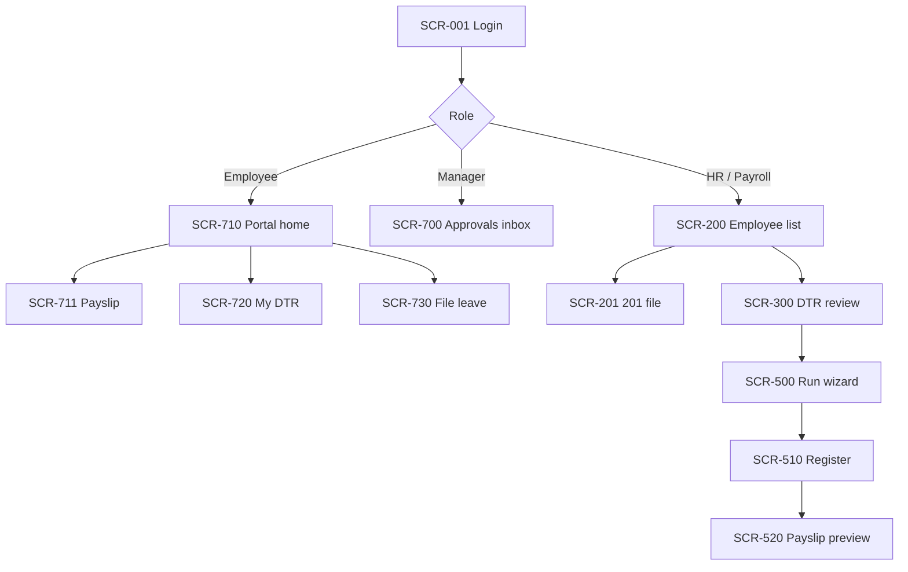

# Screens

## Purpose

Inventory of every screen with a stable `SCR-###` ID, so modules, stories and the [[Build-Plan]] can point at the same thing. This is an inventory and a set of layout rules, not mockups. Number blocks follow the module ranges in [[Conventions]], except the 700s which are the employee/manager-facing portal.

## Surfaces

| Surface | Audience | Device | Shell |
|---|---|---|---|
| Admin console | HR admin, payroll officer, sys admin | Desktop first | Left nav by module, top bar with company/period context |
| Manager view | Department heads, supervisors | Desktop + phone | Same shell, nav filtered to team scope |
| Employee portal | All employees with an account | **Phone first** | Bottom tab bar: Home, Payslips, Time, Leave, Me |

One codebase, one design system, three nav configurations driven by permissions from [[Auth-and-RBAC]]. A nav item that the user lacks permission for is not rendered; the route is still denied server-side.

## Inventory

### Access and admin (100s)

| ID | Screen | Primary user | Module | Key elements |
|---|---|---|---|---|
| SCR-001 | Login | everyone | [[Auth-and-RBAC]] | email, password, lockout message, forgot password link |
| SCR-100 | Users and roles | sys admin | [[Auth-and-RBAC]] | user table, role assignment, scope editor, active sessions with revoke |
| SCR-110 | Rate tables | payroll officer | [[Payroll]] | table_code list, effectivity timeline, `verified_at` badge, source circular field |
| SCR-120 | Holiday calendar | HR admin | [[Org-Structure]] | year grid, holiday type, per-branch overrides, copy-from-last-year |
| SCR-130 | Audit log | sys admin, DPO | [[Security-and-Compliance]] | filter by actor/entity/date, before/after diff, export |

### Employees (200s)

| ID | Screen | Primary user | Module | Key elements |
|---|---|---|---|---|
| SCR-200 | Employee list | HR admin | [[Employee-Records]] | search, filters (branch, dept, status), completeness badge, New employee |
| SCR-201 | 201 file | HR admin | [[Employee-Records]] | tabs: Personal, Employment, Compensation, Government IDs, Dependents, Documents, History |
| SCR-205 | Change request review | HR admin | [[Employee-Records]] | old vs new side by side, approve/reject with reason |
| SCR-210 | Bulk import | HR admin | [[Employee-Records]] | template download, upload, row-level validation report, commit |

### Attendance and leave (300s, 400s)

| ID | Screen | Primary user | Module | Key elements |
|---|---|---|---|---|
| SCR-300 | DTR review | payroll officer | [[Attendance-and-DTR]] | grid employee x date, status chips (OK, FLAGGED, CORRECTED, LOCKED), day drawer with raw punches |
| SCR-301 | Attendance import | payroll officer | [[Attendance-and-DTR]] | file upload, date range, preview counts, unmapped device IDs, commit/rollback batch |
| SCR-310 | Team attendance | manager | [[Attendance-and-DTR]] | scoped grid, late/absent highlights |
| SCR-410 | Leave queue | HR admin | [[Leave-Management]] | all requests, filters, override with reason |
| SCR-420 | Team leave calendar | manager | [[Leave-Management]] | month view, overlaps, balance on hover |
| SCR-430 | Leave year-end | HR admin | [[Leave-Management]] | dry-run result, carry-over and conversion preview, confirm |

### Payroll (500s)

| ID | Screen | Primary user | Module | Key elements |
|---|---|---|---|---|
| SCR-500 | Payroll run wizard | payroll officer | [[Payroll]] | steps: select period, check DTR lock, include/exclude, compute, review, release |
| SCR-510 | Payroll register | payroll officer | [[Payroll]] | one row per employee, columns per earning/deduction, footed totals, drill-down to payslip and DTR |
| SCR-520 | Payslip preview | payroll officer | [[Payroll]] | exactly what the employee will see, release gate |

### Reports (600s)

| ID | Screen | Primary user | Module | Key elements |
|---|---|---|---|---|
| SCR-600 | Report centre | payroll officer, HR | [[Reports-and-Analytics]] | report picker, parameters (tax month, period), generate, download history |

### Portal and approvals (700s)

| ID | Screen | Primary user | Module | Key elements |
|---|---|---|---|---|
| SCR-700 | Approvals inbox | manager, HR | [[Self-Service-Portal]] | one list: leave, OT, DTR corrections, change requests; approve/reject inline |
| SCR-701 | Delegation | manager | [[Self-Service-Portal]] | pick delegate and date range |
| SCR-710 | Portal home | employee | [[Self-Service-Portal]] | next pay date, last payslip, balances, pending items |
| SCR-711 | Payslip view | employee | [[Self-Service-Portal]] | one payslip, PDF download, marks `viewed_at` |
| SCR-712 | My leave balances | employee | [[Leave-Management]] | per type: entitled, used, pending, available |
| SCR-713 | My BIR 2316 | employee | [[Reports-and-Analytics]] | list by year, download, acknowledge |
| SCR-720 | My DTR | employee | [[Attendance-and-DTR]] | open cut-off, status per day, lock date visible |
| SCR-721 | Dispute DTR day | employee | [[Attendance-and-DTR]] | day, proposed times, reason, attachment |
| SCR-722 | File overtime | employee | [[Attendance-and-DTR]] | date, hours, reason |
| SCR-730 | File leave | employee | [[Leave-Management]] | type first, balance shown before dates, half-day option, attachment |
| SCR-731 | My leave requests | employee | [[Leave-Management]] | status, cancel request |
| SCR-740 | My 201 | employee | [[Self-Service-Portal]] | read view, inline edit of non-sensitive fields |
| SCR-741 | Sensitive field change | employee | [[Self-Service-Portal]] | new value, supporting document, goes to SCR-205 |
| SCR-742 | Document request | employee | [[Offboarding-and-Clearance]] | COE and similar, status tracking |

## Layout and interaction rules

1. **Money is right-aligned, tabular figures, two decimals, peso sign in headers not cells.** Totals row is sticky.
2. **Every derived number is drillable.** Net pay to earnings to DTR day to raw punches. This is exit criterion 4 in [[Roadmap]].
3. **Status is a chip with a stable code and a label**, never colour alone (accessibility; also works on a printed register).
4. **Destructive or irreversible actions** (release payroll, lock DTR, year-end) use a confirm dialog that restates the count and period: "Release 287 payslips for 16-31 Oct?".
5. **Approvals are two taps from a notification** (see [[Notifications]]): deep link opens SCR-700 filtered to the item.
6. **Empty states say what to do next**, e.g. "No DTR for this cut-off. Import attendance (SCR-301)".
7. **Forms validate on the server and echo field errors inline.** Client checks are convenience only.
8. **Phone breakpoints**: the 700-series must work at 360px with no horizontal scroll. Admin screens may require desktop; say so in a banner rather than rendering broken.
9. **Period context**: payroll and DTR screens show the active cut-off and its lock state in the top bar at all times.
10. **Language**: English UI for MVP; labels stored as keys so Filipino can be added later without touching templates.

## Navigation sketch

## Open Questions

- [ ] Is a Filipino-language UI required at launch, or only for payslips? (Q10 in [[Open-Questions]])
- [ ] Do field employees without accounts need a kiosk mode on a shared device? (Q15)

## Related

[[Self-Service-Portal]] · [[Auth-and-RBAC]] · [[User-Stories]] · [[Personas]] · [[API-Surface]] · [[Build-Plan]] · [[Architecture]]
