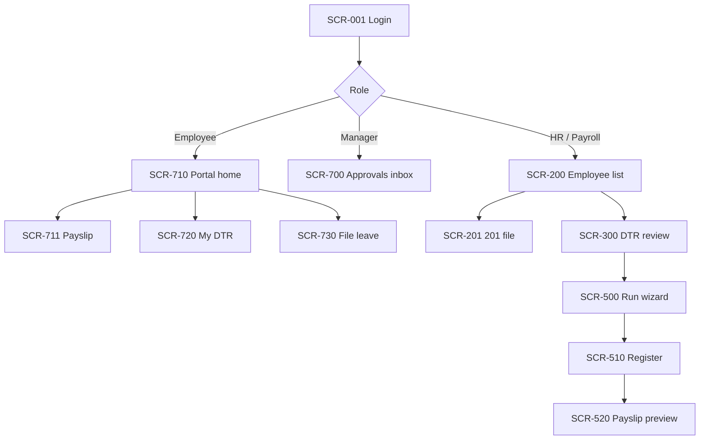

# Screens

## Purpose

Inventory of every screen with a stable `SCR-###` ID, so modules, stories and the [[Build-Plan]] can point at the same thing. This is an inventory and a set of layout rules, not mockups. Number blocks follow the module ranges in [[Conventions]], except the 700s which are the employee/manager-facing portal.

## Surfaces

| Surface | Audience | Device | Shell |
|---|---|---|---|
| Admin console | HR admin, payroll officer, sys admin | Desktop first | Left nav by module, top bar with company/period context |
| Manager view | Department heads, supervisors | Desktop + phone | Same shell, nav filtered to team scope |
| Employee portal | All employees with an account | **Phone first** | Bottom tab bar: Home, Payslips, Time, Leave, Me |

One codebase, one design system, three nav configurations driven by permissions from [[Auth-and-RBAC]]. A nav item that the user lacks permission for is not rendered; the route is still denied server-side.

## Inventory

### Access and admin (100s)

| ID | Screen | Primary user | Module | Key elements |
|---|---|---|---|---|
| SCR-001 | Login | everyone | [[Auth-and-RBAC]] | email, password, lockout message, forgot password link |
| SCR-100 | Users and roles | sys admin | [[Auth-and-RBAC]] | user table, role assignment, scope editor, active sessions with revoke |
| SCR-110 | Rate tables | payroll officer | [[Payroll]] | table_code list, effectivity timeline, `verified_at` badge, source circular field |
| SCR-120 | Holiday calendar | HR admin | [[Org-Structure]] | year grid, holiday type, per-branch overrides, copy-from-last-year |
| SCR-130 | Audit log | sys admin, DPO | [[Security-and-Compliance]] | filter by actor/entity/date, before/after diff, export |

### Employees (200s)

| ID | Screen | Primary user | Module | Key elements |
|---|---|---|---|---|
| SCR-200 | Employee list | HR admin | [[Employee-Records]] | search, filters (branch, dept, status), completeness badge, New employee |
| SCR-201 | 201 file | HR admin | [[Employee-Records]] | tabs: Personal, Employment, Compensation, Government IDs, Dependents, Documents, History |
| SCR-205 | Change request review | HR admin | [[Employee-Records]] | old vs new side by side, approve/reject with reason |
| SCR-210 | Bulk import | HR admin | [[Employee-Records]] | template download, upload, row-level validation report, commit |

### Attendance and leave (300s, 400s)

| ID | Screen | Primary user | Module | Key elements |
|---|---|---|---|---|
| SCR-300 | DTR review | payroll officer | [[Attendance-and-DTR]] | grid employee x date, status chips (OK, FLAGGED, CORRECTED, LOCKED), day drawer with raw punches |
| SCR-301 | Attendance import | payroll officer | [[Attendance-and-DTR]] | file upload, date range, preview counts, unmapped device IDs, commit/rollback batch |
| SCR-310 | Team attendance | manager | [[Attendance-and-DTR]] | scoped grid, late/absent highlights |
| SCR-410 | Leave queue | HR admin | [[Leave-Management]] | all requests, filters, override with reason |
| SCR-420 | Team leave calendar | manager | [[Leave-Management]] | month view, overlaps, balance on hover |
| SCR-430 | Leave year-end | HR admin | [[Leave-Management]] | dry-run result, carry-over and conversion preview, confirm |

### Payroll (500s)

| ID | Screen | Primary user | Module | Key elements |
|---|---|---|---|---|
| SCR-500 | Payroll run wizard | payroll officer | [[Payroll]] | steps: select period, check DTR lock, include/exclude, compute, review, release |
| SCR-510 | Payroll register | payroll officer | [[Payroll]] | one row per employee, columns per earning/deduction, footed totals, drill-down to payslip and DTR |
| SCR-520 | Payslip preview | payroll officer | [[Payroll]] | exactly what the employee will see, release gate |

### Reports (600s)

| ID | Screen | Primary user | Module | Key elements |
|---|---|---|---|---|
| SCR-600 | Report centre | payroll officer, HR | [[Reports-and-Analytics]] | report picker, parameters (tax month, period), generate, download history |

### Portal and approvals (700s)

| ID | Screen | Primary user | Module | Key elements |
|---|---|---|---|---|
| SCR-700 | Approvals inbox | manager, HR | [[Self-Service-Portal]] | one list: leave, OT, DTR corrections, change requests; approve/reject inline |
| SCR-701 | Delegation | manager | [[Self-Service-Portal]] | pick delegate and date range |
| SCR-710 | Portal home | employee | [[Self-Service-Portal]] | next pay date, last payslip, balances, pending items |
| SCR-711 | Payslip view | employee | [[Self-Service-Portal]] | one payslip, PDF download, marks `viewed_at` |
| SCR-712 | My leave balances | employee | [[Leave-Management]] | per type: entitled, used, pending, available |
| SCR-713 | My BIR 2316 | employee | [[Reports-and-Analytics]] | list by year, download, acknowledge |
| SCR-720 | My DTR | employee | [[Attendance-and-DTR]] | open cut-off, status per day, lock date visible |
| SCR-721 | Dispute DTR day | employee | [[Attendance-and-DTR]] | day, proposed times, reason, attachment |
| SCR-722 | File overtime | employee | [[Attendance-and-DTR]] | date, hours, reason |
| SCR-730 | File leave | employee | [[Leave-Management]] | type first, balance shown before dates, half-day option, attachment |
| SCR-731 | My leave requests | employee | [[Leave-Management]] | status, cancel request |
| SCR-740 | My 201 | employee | [[Self-Service-Portal]] | read view, inline edit of non-sensitive fields |
| SCR-741 | Sensitive field change | employee | [[Self-Service-Portal]] | new value, supporting document, goes to SCR-205 |
| SCR-742 | Document request | employee | [[Offboarding-and-Clearance]] | COE and similar, status tracking |

## As built: HR requests and ticket screens (750s, verified 2026-10-25)

Server-rendered PHP pages addressed as `?page=<id>`; the sidebar groups are built in `app/View.php`. A nav item is shown only if the permission passes; the page is still refused server-side. Hub: [[Employee-Tickets]]. UI rules: [[Design-System]].

| ID | Screen (nav label) | Page id | Gate | Module |
|---|---|---|---|---|
| SCR-750 | HR Concerns (my requests) | `hr-requests-my` | `tickets.request_self` or `ticket.file_for_others` | [[Employee-Tickets]] |
| SCR-751 | File an HR Request (types limited to `ticket.file.<type>`) | `hr-request-new` | same + per-type permission | [[Employee-Tickets]] |
| SCR-752 | Ticket page: header card, status stepper, HR response card, details, chat thread, collapsed History; HR form splits "Response to the employee" and "Internal note (HR only)" | `hr-request` | read gate (requester, HR, named approver, Accounting, viewer) | [[Employee-Tickets]] |
| SCR-753 | HR Request Inbox (Manager/ADL approvals) | `hr-request-inbox` | `payroll.approve_manager` or `payroll.approve_adl` | [[Employee-Tickets]] |
| SCR-754 | Team Requests (read-only) | `hr-request-team` | `ticket.view_team` | [[Employee-Tickets]] |
| SCR-755 | HR Request Queue: tabs with counts, search, filter chips, age colour, preview drawer, quick In Progress/Served/Cancel, bulk Served/Cancel (ATM, ID, Uniform), uniform size summary, CSV | `hr-service-requests` (+ `hr-request-preview`, `hr-service-requests-export`) | `tickets.review_hr`, non-employee portal | [[Employee-Tickets]] |
| SCR-756 | Payroll Concerns (HR) | `hr-payroll-concerns` | `tickets.review_hr` | [[Payroll]] |
| SCR-757 | Accounting Follow-up (completed NetSuite concerns) | `hr-accounting-requests` | `ticket.accounting.view` membership | [[Employee-Tickets]] |
| SCR-758 | **I4: now the Incident Cases queue** (status tabs with counts, search, category/branch/date filters, aging, stacked cards under 760px; Case page Back keeps the view; BR-782). Previously: Incident Feed (HR and readers of cases; **I1: read gate is now the case rule BR-769, not `ticket.sensitive.view`**). Planned replacement by Incident Reports module screens (My Incidents, File an Incident, Case page, HR Incident Cases) in phases I2 to I4 of [[2026-10-25-incident-report-module]] | `hr-incidents` | case readers (`TicketRepository::listing` mode `feed`) | [[Employee-Tickets]] |
| SCR-759 | HR dashboard: greeting/navigation, Company and existing Period filters, six KPI cards linking to the filtered queue, requests-by-type bars, pending-age chart, Requires attention panel; action strip removed, three setup warnings deep-link to focused/expanded Ticket Viewers (BR-788). Period picker/report parity deferred. | `hr-dashboard` | HR portal | [[Employee-Tickets]] |
| SCR-760 | Ticketing Report (+ CSV, one-page A4 print) | `hr-ticket-report`, `-export`, `-print` | `ticket.report.view` + HR portal | [[Employee-Tickets]] |
| SCR-761 | Ticket Approvers (Manager/ADL assignments, preview before save) | `hr-ticket-approvers` | `tickets.approvers.manage` | [[Employee-Tickets]] |
| SCR-762 | Ticket Viewers (read-only problem report) | `hr-ticket-viewers` | `tickets.approvers.manage` | [[Org-Structure]] |
| SCR-763 | Accounting Members | `hr-ticket-accounting-members` | `tickets.review_hr` | [[Employee-Tickets]] |
| SCR-764 | Printable HR Forms (SW / OFJI) | `hr-print-forms` | `tickets.review_hr` | [[Employee-Tickets]] |
| SCR-765 | COE Template (upload .docx, activate version, signatory settings) + COE preview/download | `hr-coe-template`, `hr-coe-preview`, `hr-coe-download`, `hr-coe-template-file` | `ticket.coe.template.manage` (template); preview HR; download requester + HR | [[Employee-Tickets]] |
| SCR-766 | Users / Roles & Permissions (per-type filing grants, ADL/SC/OIC/TC) | `admin-users`, `admin-roles` | users/roles permissions | [[Auth-and-RBAC]] |
| SCR-767 | Employee 201, Employment tab, panel "Who can view this employee's tickets" (read-only, red PROBLEM lines) | `hr-employee` | employee view | [[Org-Structure]] |
| SCR-768 | My Incidents (cases I filed or was given access to; status chip, last update, no other people's role labels) | `incident-mine` | any employee/HR/admin account (list is BR-769 scoped) | [[Employee-Tickets]] |
| SCR-769 | File an Incident: Employee Information for the filer, Incident Details with eight template nature choices/date/start/optional end/free names, Incident Description, Initial Action Taken, Customer Involved, Supporting Documents; account participant picker separate from document names. Immutable official DOCX generated on submit; failed input retained, success opens case. No Employee 201 link message retained. BR-784..786. | `incident-new` | `ticket.file.incident` + linked Employee 201 | [[Employee-Tickets]] |
| SCR-770 | Incident Case page: header/pipeline -> official document -> conversation -> composer; rail: visible status form and collapsible HR-only notes, people, summary, attachments and timeline. Counts and latest visible event show while collapsed; rail follows main content on mobile. Original report is inline (PDF or read-only sheet) with download kept. Excluded HR sees explanation. Official document access remains reporter/handler only; PDF fallback and handler retry; legacy no-document state. BR-787. | `hr-request&id=` (incident cases) | reader per BR-769; HR panel handler only (BR-780), document gate BR-787 | [[Employee-Tickets]] |

Sidebar: group **Requests** (all portals) holds the ticket screens; group **HR Request Setup** (third group for HR and Admin portals) holds Ticket Approvers, Ticket Viewers, Accounting Members, COE Template, Printable HR Forms. The older SCR-7xx rows above are the design target; where both exist, the page ids here are the built ones.

## Layout and interaction rules

1. **Money is right-aligned, tabular figures, two decimals, peso sign in headers not cells.** Totals row is sticky.
2. **Every derived number is drillable.** Net pay to earnings to DTR day to raw punches. This is exit criterion 4 in [[Roadmap]].
3. **Status is a chip with a stable code and a label**, never colour alone (accessibility; also works on a printed register).
4. **Destructive or irreversible actions** (release payroll, lock DTR, year-end) use a confirm dialog that restates the count and period: "Release 287 payslips for 16-31 Oct?".
5. **Approvals are two taps from a notification** (see [[Notifications]]): deep link opens SCR-700 filtered to the item.
6. **Empty states say what to do next**, e.g. "No DTR for this cut-off. Import attendance (SCR-301)".
7. **Forms validate on the server and echo field errors inline.** Client checks are convenience only.
8. **Phone breakpoints**: the 700-series must work at 360px with no horizontal scroll. Admin screens may require desktop; say so in a banner rather than rendering broken.
9. **Period context**: payroll and DTR screens show the active cut-off and its lock state in the top bar at all times.
10. **Language**: English UI for MVP; labels stored as keys so Filipino can be added later without touching templates.

## Navigation sketch

## Open Questions

- [ ] Is a Filipino-language UI required at launch, or only for payslips? (Q10 in [[Open-Questions]])
- [ ] Do field employees without accounts need a kiosk mode on a shared device? (Q15)

## Related

[[Self-Service-Portal]] · [[Auth-and-RBAC]] · [[User-Stories]] · [[Personas]] · [[API-Surface]] · [[Build-Plan]] · [[Architecture]]

Hub for HR requests: [[Employee-Tickets]] · UI rules: [[Design-System]]

### Ticket detail components (P1, 2026-10-25)
Request detail (`hr-request`) uses shared pieces from `tickets.css`: stepper states done, current, skipped (dash), stop, warn, todo; status chip and pill with a gray tone; Approval chain as a vertical timeline (avatar initials, role, name, status chip, date); empty state for no comments; comment composer; every date through `ticket_time()`. Layout (two columns, Payroll Concern on the same page) is P2 of [[2026-10-25-ticketing-ui-ux-redesign]]. No new screen or route.

## 2026-10-29 - PMBSI departments (prepared)
- Organization Setup separates 2LOG and PMBSI Departments; Employee 201 Add/Edit filters department choices by work company. Visual and runtime behavior not verified.

- 2026-10-29: Organization Setup positions split by existing Employee Add/Edit eligibility into 2LOG, PMBSI and Needs classification. Company add validates name and optional active company department; shared records and eligibility unchanged, no schema or data migration. PHP lint passed; browser, application and DB behavior unverified.

- 2026-10-29: Organization Setup rows and position department editor use responsive wrapping and focusable compact actions; status wording uses Deactivate, Reactivate and Inactive. Visual behavior unverified.

## 2026-10-29 - Organization Setup side-by-side UI/UX

- Organization Setup implementation: name/status heading, metadata second line, actions below across every master card; labeled Add forms and full-width Position name. Native details keeps the department editor below its summary/toggle row. Existing two-column desktop and one-column narrow card layout retained, with wrapping names and responsive form grids. Rendered layout and interaction remain unverified.

## 2026-10-31 - My Profile
- SCR My Profile (employee-profile): own record only, read-only, tabs Personal / Contact and Address / Employment / IDs and Documents, quick-link strip, print summary (A4). Opened from the Employee sidebar and the top-right Profile menu (employee, hr and admin portals). Related: [[Self-Service-Portal]], [[Employee-Records]].

## 2026-10-31 - HR Dashboard v2 (`hr-dashboard`)
Slim header (greeting, Employee directory, Open HR Request Queue). Filter bar: Company select + Period segmented control (links, `aria-current`). KPI tiers: Needs action (Pending requests, In progress, Incident Reports) and Overview (Served, Recruitment, Active employees); same values and links as before. Requests by type + wait-time bars on the left; Oldest pending requests, Incident Reports and Setup warnings (count chips, "All clear") on the right. Recruitment pulse shows no bar for a zero stage and an empty state. Panel links are plain text links.

## 2026-10-31 - Team Requests lead additions
- Team Requests (`hr-request-team`): "New" badge beside the ticket number while the lead's notification is unread. Request detail (lead, read-only): panel "Follow up with HR" button; after use it shows a disabled "Followed up" state for 24h.

- 2026-11-02 Change password (page change-password, any signed-in user; forced at first sign-in). Users and Access: no Create New User card; password column with audited eye for HR and Super Admin; read-only for HR. Create Employee: Role field and read-only company email (portal login).

- 2026-11-02 Employees directory (hr-employees): warning notice "N active employee(s) have no portal account" with a collapsible names list and Generate all accounts (confirm), only for employees.manage with users.view_credentials; result panel after a run (created, skipped with reason, no passwords). Employee 201 File > Employment: Portal account field = role select plus Generate account when unlinked, read-only email when linked, "No account" note for archived. Users and Access: Role card renamed Change role; Save employee link removed.

- 2026-11-02 Users and Access (admin-users): row menu now offers Remove account (confirm names the person and says the employee record is kept) for users with users.remove; "No available actions" only shows when nothing applies. Collapsible Removed accounts panel (name, original email, role, employee, removed date) with Restore account, shown only to users with users.remove.

- 2026-11-02 Manpower Requests (hr-manpower): Open / Declined / All filter, columns Request, Source, Employer, Position, Requested, Filled (filled / requested), Priority, Status, Target and Actions. Awaiting tickets show Approve and Decline only for HR ticket reviewers with recruitment.manage. Approve dialog: employer select or "Or add a new employer", position title, priority, optional remarks. Decline dialog: reason (required). The manual create form is now open to every user with recruitment.manage and also accepts a new employer inline. The applicant page stage actions card now uses recruitment.manage instead of three role codes.

## 2026-11-02 - Job Openings (`hr-jobs`, rec-jobs)
HR > Recruitment > Job Openings (menu, recruitment.view; actions need recruitment.manage). Tabs All / Draft / Published / Closed plus title/code search. Table: code, job, employer (with a note that the public sees PMBSI), type, openings, applications, status badge (Draft, Published, Expired, Closed), closes, actions (Edit, Publish, Unpublish, Close, Reopen). One plain form above the table (no script) for + New job, Post job (from Manpower Requests, ?request_id=) and Edit (?edit=); walk-in jobs show an Employer select with "Or add a new employer". Save as draft or Save and publish. Manpower Requests: the create form is gone; approved ticket rows show Post job and the count of open jobs. The Pipeline header button is + New job. Public job card, job page, Apply select and tracker show PMBSI.

## 2026-11-02 - HR Applicant profile redesign and Apply page (rec-apply-job)
`hr-applicant`: header band (name, "Applied for", client, applied date, mailto/tel contacts, Download resume), stage tracker (Applied to Deployed, read-only; moving still uses Stage & actions), tabs Resume (inline PDF or download) / Application (Job details + screening answer) / Interviews. Offer, Deployment, Endorsement, conversion and the timeline are unchanged. `hr-applicants` list gains Type and Location columns. Public `apply`: the position is read-only text from the clicked job; header and footer Apply Now go to Careers.

Update 2026-11-02: hr-applicant Stage & actions no longer lists the normal stages. Manual status is only Rejected / Withdrawn / On Hold / Returned (and "Resume at" to get back into the flow); Start screening button at Applied; the rest advances automatically.

Update 2026-11-02 (2): hr-applicant Update defaults to "Continue to <next stage>" (POST move_stage target_stage=NEXT, server-resolved, only before Offer); exceptions stay optional. Start screening button removed.

## 2026-11-02 - rec-endorse-manager
hr-applicant: the Client endorsement card is replaced by Endorse to Manager review (name filter, reviewer checkboxes with role, note, Endorse) plus a Manager review list of who was endorsed and what they answered (Proceed, Not suitable, Another interview, Waiting). Employee portal sidebar: Candidates for review (permission recruitment.review) with an unread badge. review-candidates: table of candidates endorsed to me. review-candidate: candidate facts, resume preview, interviews, Your decision form and Schedule an interview form. Stage label Manager Review replaces Client Review in badges, tracker, history and counts.

## 2026-11-02 - interview-invite and interview-chain
hr-applicant: Location or meeting link says the applicant is emailed; Interviews tab shows Resend invite per interview; Endorse card has a Final tick per person; Manager review list shows Final interviewer and passed by; a Final interview done, next: Offer card (Move to Offer) appears when the final interviewer proceeded. review-candidate: Proceed (renamed from Proceed to offer) with a hint, Final interviewer badge, a Pass to next interviewer card (people list with a Final tick and a note) while in Manager Review.

## 2026-11-02 - offer-rate-type
hr-applicant Offer card: Rate type select (Monthly rate / Daily rate / Hourly rate, default Monthly) + peso Rate input + live Monthly / Daily / Hourly line. Saved offer shows e.g. "₱800.00 / day (≈ ₱20,800.00 / month)". Re-opening a Daily offer pre-selects Daily. Offer card only; Job Openings salary unchanged.

## 2026-11-02 - offer-working-days
hr-applicant Offer card: Working days per month select (26 days (Mon-Sat) default, 22 days (Mon-Fri)) under Rate type / Rate; the live line and the saved offer summary ("... , 22 days/month (≈ ...)") use it. Always shown for every rate type.

## Addendum 2026-11-02 - Convert to Employee: automatic portal account
Recruitment > Applicants > Convert to Employee: the "Employee portal access / Account setup" card is gone. Employment assignment now shows Employer (PMBSI, read-only), a required Company select (2LOG / PMBSI, filled from the chosen Department, limits the Department list to that company), and Company email is a read-only live preview (firstnamelastname@2log.com or @pmbsi.com) with the note that it is created automatically. The confirm checkbox reads "...automatic portal account details". Password is not shown here; HR uses the reveal button on the employee profile. See BR-879.

## 2026-11-02 - HR Appearance palette list (local, not committed)
HR portal role only: Appearance in the top-right profile menu expands an inline list of 5 radio options (Light, Dark, Soft Beige, Earth Tones, Soft Pastel) with a colour swatch and a check mark on the active one. Choosing one applies at once and saves through POST palette-save; on failure the page reverts and shows "Could not save your choice. Reload the page and try again." Keyboard: Enter opens, Arrow Up/Down move, Escape closes the list and returns focus to Appearance. The topbar moon button for HR flips between Dark and the last light palette. Admin, Payroll, Manager and Employee pages keep the one-click Light/Dark toggle. The saved palette is written on the html tag by the server (data-theme, data-palette, data-palette-user) so there is no flash. Files: app/View.php, app/UserPalette.php, public/assets/palette-menu.css, public/assets/palettes.css, public/assets/hris-app.js.

Update 2026-11-02: the Appearance list now has 6 options (Light, Dark, Soft Beige, Earth Tones, Soft Pastel, Soft Pink).

Update 2026-11-02: My Profile avatar is clickable (camera badge) to change your own photo.

Update 2026-11-02: My Profile avatar opens a photo dialog (view, or choose then crop to a square before upload).

Update 2026-11-03: hr-applicant is two columns (.ap-grid): main = header, stage tracker, Stage & actions, Schedule interview, Offer/Deployment, Resume/Application/Interviews tabs; sticky side column (.ap-side) = Screening rating, Endorse to Hiring review, Activity timeline. Under 1100px it is one column. The stage formerly labelled Manager Review reads Hiring Review everywhere (label only).

Update 2026-11-03 (T3): hr-applicant and review-candidate show an Interview scorecard card (5 criteria x 1-5, recommendation, note) below the Screening rating, only for scorers and only from the Interview stage. POST action save_scorecard (CSRF, permission, validation in RecruitmentRepository::saveScorecard). HR also sees one line per scorer with the average and a recommendation badge.

Update 2026-11-03 (declutter): hr-applicant sections Schedule interview, Offer, Deployment, Resume/Application/Interviews and Activity timeline are collapsible (
); only the section for the current stage is open by default. Scorecard and Hiring review cards stay as they are.
