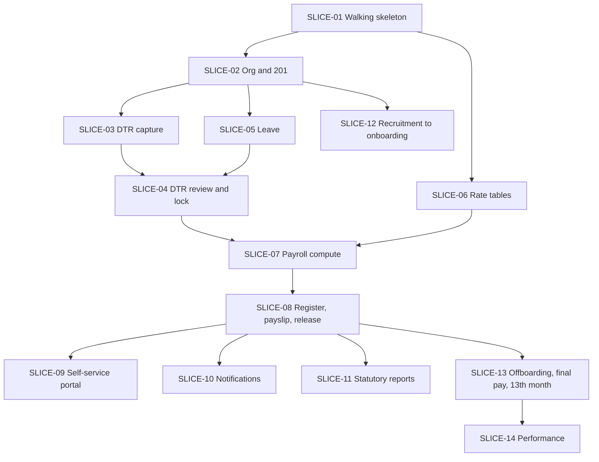

# Build Plan

## Purpose

Vertical slices in dependency order. Each slice cuts through schema, domain, service, API, UI and tests, and ends demoable. The first slice is a **walking skeleton**: thinnest possible end-to-end path, deployed, before any depth. Outcome-level view is in [[Roadmap]]; progress ticks in [[Progress]]; hand-off text in [[Claude-Code-Brief]].

## Ground rules

1. A slice is done only when its **Done when** list passes, tests included. No "mostly".
2. Every `BR-###` touched gets a test named `test_BR_###_*` ([[Business-Rules]]).
3. Schema changes only via migrations. Seed data via seeders, with fake Filipino names.
4. Domain classes (`PayrollCalculator`, `DtrDeriver`, `AccrualEngine`) are pure; tests need no database.
5. Do not build on a `proposed` ADR except where this plan says stack-neutral. Blocking questions are listed per slice.
6. Brownfield: before each slice, inventory what the existing PHP code already does (see [[Architecture]]), then keep, adapt or replace; record the choice in [[Progress]].

## Dependency graph

## Slices

### SLICE-01 Walking skeleton (Phase 0)

- **Goal:** login, one protected page per portal, create department and employee, audit row written, deployed from a clean checkout.
- **Modules:** [[Auth-and-RBAC]] (users, roles, sessions), [[Org-Structure]] (departments only), [[Employee-Records]] (minimal list/create), audit log.
- **Entities:** `users`, `roles`, `user_roles`, `user_scopes`, `user_sessions`, `auth_events`, `audit_log`, `companies`, `departments`, `employees`.
- **FRs:** the Must FRs for login/session/audit in the module tables.
- **Screens:** SCR-001, SCR-200 (stub), department admin.
- **Tests:** login lockout, session expiry, scope filter unit test, audit append-only (DB grant).
- **Blocked by:** Q1 ([[ADR-002-Multi-Tenancy]]) must be answered before migrations; Q2 preferably.
- **Done when:** HR admin logs in, creates department and employee, and the action appears in `audit_log`; CI runs tests green; README explains run steps.

### SLICE-02 Org and 201 file

- **Goal:** full employee record with dated history.
- **Entities:** `branches`, `positions`, `cost_centers`, `employment_statuses`, `employee_status_history`, `employee_placements`, `employee_compensation`, `employee_government_ids`, `employee_contacts`, `employee_dependents`, `employee_documents`, `holidays`/`holiday_calendars`.
- **Rules:** BR-101-108, BR-201-208, BR-224.
- **Screens:** SCR-200, SCR-201, SCR-210, SCR-120.
- **Done when:** overlapping dated rows are rejected at DB and service level; payroll-ready check (BR-202) returns reasons; bulk import of the real roster validates row by row; documents download only via authorised endpoint.
- **Blocked by:** Q7, Q8, Q17.

### SLICE-03 DTR capture

- **Goal:** raw punches in, derived days out, for one cut-off.
- **Entities:** `attendance_devices`, `attendance_raw_logs`, `shift_templates`, `employee_schedules`, `dtr_days`, `dtr_sessions`.
- **Domain:** `DtrDeriver` (pure). Rules BR-301-312.
- **Screens:** SCR-301, SCR-300 (read only).
- **Done when:** a real device export imports idempotently (same file twice = no change); night-shift fixtures attribute hours to start date (BR-107/BR-309); derivation golden tests pass with hand-checked expected values.
- **Blocked by:** Q5 (device format), Q4 (cut-off), ADR-004 (not yet written).

### SLICE-04 DTR review, corrections, lock

- **Goal:** exceptions resolved, period locked, DTR immutable.
- **Entities:** `dtr_corrections`, `overtime_requests`, `payroll_periods` (lock fields).
- **Done when:** missing-attendance exception list works; corrections audited and trigger re-derivation; locked days reject changes; unlock requires reason and logs; OT approval caps paid OT (BR-303).

### SLICE-05 Leave

- **Goal:** types, accrual, filing, approval, balance ledger; paid leave flows to DTR.
- **Entities:** `leave_types`, `leave_requests`, `leave_ledger`, `leave_approvals`, `approval_delegations`.
- **Domain:** `AccrualEngine`. Rules BR-401-412.
- **Screens:** SCR-410, SCR-420, SCR-730 (admin-side first).
- **Done when:** balance equals the sum of ledger rows; accrual run twice = same result (BR-408); approved paid leave appears as `leave_hours` in `dtr_days`.
- **Blocked by:** Q6, ADR-005.

### SLICE-06 Rate tables and pay rules

- **Entities:** `rate_tables`, `rate_table_rows`, `pay_rules`.
- **Screens:** SCR-110.
- **Done when:** version create, verify (different user), effectivity overlap blocked, unverified version unusable (BR-514). **Seed with placeholders marked unverified**; no real figures committed until John supplies verified ones ([[PH-Labor-and-Payroll-Notes]]).
- **Blocked by:** Q3 ([[ADR-003-Payroll-Engine-Approach]]), Q22-Q27.

### SLICE-07 Payroll compute

- **Goal:** compute a run from locked DTR and compensation; no release yet.
- **Entities:** `payroll_runs`, `payroll_run_employees`, `payroll_run_lines`, `employee_loans`, `employee_allowances`.
- **Domain:** `PayrollCalculator` (pure). Rules BR-501-515.
- **Done when:** golden-case suite (hand-computed by the payroll officer) passes to the centavo; snapshot and `rate_table_version_set` stored; `recompute-check` diff empty; framework test harness already in place (ADR-001 decided by now).
- **Blocked by:** Q4, Q8, Q11, Q12, ADR-001.

### SLICE-08 Register, payslip, release, reversal

- **Screens:** SCR-500, SCR-510, SCR-520.
- **Entities:** `payslips`, `payroll_adjustments`.
- **Done when:** register foots; payslip renders from snapshot (BR-703); release is irreversible except via adjustments; separation of duties enforced (BR-114/BR-119); drill-down net pay to raw punch works. **MVP exit criteria in [[Roadmap]] are checked here.**
- **Blocked by:** Q9, Q10, ADR-009.

### SLICE-09 Self-service portal (Phase 2)

- SCR-700-742. Phone-first. Payslips, DTR, leave filing, 201 view, change requests. See [[Self-Service-Portal]]. Blocked by Q15.

### SLICE-10 Notifications

- Outbox, email channel, in-app, deep links, reminders. See [[Notifications]]. Blocked by Q16.

### SLICE-11 Statutory reports

- SSS, PhilHealth, Pag-IBIG lists, BIR alphalist and 2316, payroll journal. See [[Reports-and-Analytics]]. Blocked by Q21 and verified formats.

### SLICE-12 Recruitment to onboarding

- Applicant pipeline (adapt existing), offer, convert to employee without re-typing, onboarding checklist. See [[Recruitment-and-Onboarding]].

### SLICE-13 Offboarding, final pay, 13th month

- Clearance gating, final pay computation, 13th month run, 2316. See [[Offboarding-and-Clearance]], [[Payroll]].

### SLICE-14 Performance (Phase 3)

- Review cycles, goals. See [[Performance-Management]].

## Cross-slice foundations (do once, early)

| Item | Where |
|---|---|
| CI running tests on every push | SLICE-01 |
| Seeder with fake Filipino data | SLICE-01 |
| Structured logging with request_id | SLICE-01 |
| Backup script and tested restore | before first real data, ideally SLICE-02 |
| Staging with anonymised data | before first real payroll run (SLICE-08) |

## Open Questions

- [ ] Order of 05 vs 04: leave first or DTR lock first? Default above builds both, then locks.
- [ ] How much of the existing codebase can be kept per slice? Needs the inventory step in ground rule 6.

## Related

[[Roadmap]] · [[Progress]] · [[Claude-Code-Brief]] · [[Architecture]] · [[Open-Questions]] · [[Decision-Log]] · [[Data-Model]]
